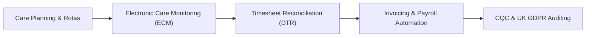
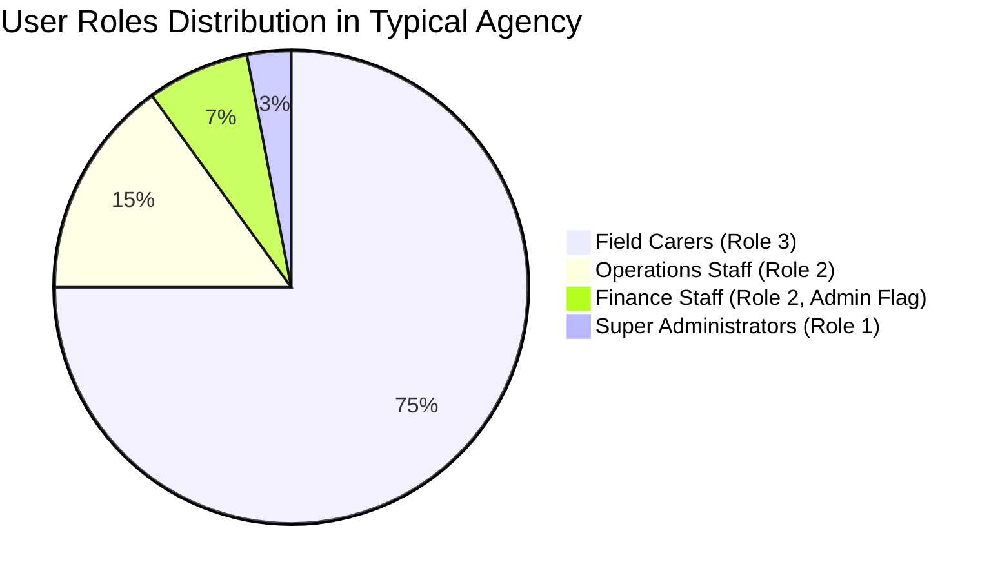

# Mary Care Management System — Executive Overview

**Document File:** `docs/01-executive-overview.md`  
**Target Audience:** Executives, Product Owners, Agency Directors, Clinical Managers, Auditing Bodies  
**Release Version:** 1.0.0 Production  
**Date:** October 2026  

---

## 1. Project Purpose

The **Mary Care Management System** is a purpose-built, enterprise-grade software platform designed to manage the full operational lifecycle of UK domiciliary (home care) and supported living care agencies. 

Social care delivery in the United Kingdom requires balancing intricate logistics, statutory accountability, and compassionate service delivery. Agencies must schedule visits with strict client-to-carer matching, ensure real-time attendance verification, reconcile complex pay and charge rates, and comply with strict statutory standards set by the **Care Quality Commission (CQC)** and the **Data Protection Act 2018 (UK GDPR)**.

The modernized Mary Care platform replaces legacy, error-prone manual spreadsheets and legacy monolithic web applications with a modern, cloud-native application combining an intuitive web portal with an asynchronous, high-concurrency backend.

---

## 2. Business Objectives

1. **Eliminate Operational Overhead:** Automate recurring rota generation, shift allocation, and timesheet compilation to reduce weekly office administrative overhead by up to 70%.
2. **Accurate Billing & Payroll:** Seamlessly cross-reference client billable rates and carer pay rates across varied shift types (Standard, Weekend, Night, Bank Holiday) with automated zero-discrepancy exports.
3. **CQC Regulatory Compliance:** Ensure every clinical visit produces verified timestamps, digital care notes, medication administration logs, and accountability audits that satisfy CQC *Safe*, *Effective*, and *Well-Led* inspection criteria.
4. **Data Protection by Design:** Protect sensitive patient records (Article 9 Special Category Health Data) through automated access logging, role-based boundary enforcement, and one-click statutory Subject Access Request (SAR) compliance.
5. **Modernized User Experience:** Provide care coordinators, administrators, and field staff with a responsive, modern interface featuring unified dark/light themes, instant search, and real-time validation.

---

## 3. Key System Features

### 3.1 Care Rota Planning & Scheduling
- **Visual Rota Canvas:** Interactive calendar view for allocating daily and weekly visits across service users and qualified care staff.
- **Recurrence Engine:** Generates recurring shift patterns across configurable cycles (weekly, fortnightly, monthly).
- **Competency & Constraint Matching:** Ensures assigned carers meet mandatory client requirements (e.g., female-only carer requests, hoist training, dementia care certification).

### 3.2 Electronic Care Monitoring (ECM) & Attendance
- **Mobile-Responsive Carer Portal:** Dedicated touch-friendly portal for field staff to review assigned calls, clock-in, log care notes, record medication administration, and clock-out.
- **GPS Geofencing:** Optional proximity verification ensuring clock-in events occur within an authorized radius of the client's residence.
- **Automated Care Notes PDF:** Instantly converts completed visit notes and clinical checklists into professional, NHS-styled PDF summaries for service user records.

### 3.3 Daily Time Record (DTR) Reconciliation
- **Real-Time Timesheets:** Compiles planned visit durations against actual clock-in/out timestamps.
- **One-Click Variance Resolution:** Highlights late arrivals, extended visits, or missed calls for coordinator sign-off.
- **Automated Time Generation:** Administrative utilities for rapid timesheet validation and batch approvals.

### 3.4 Finance, Payroll & Invoicing
- **Multi-Tier Rate Matrix:** Cross-references active clients against shift types to define granular billable rates and carer pay rates.
- **Payroll Batching:** Automatically compiles verified hours for payroll export into major accounting platforms.
- **Client & Commissioner Invoicing:** Generates itemized invoices grouped by private clients or NHS/Local Authority commissioners.

### 3.5 UK GDPR & Clinical Governance
- **Article 9 Audit Logging:** Every view or export of confidential health files is automatically logged with staff ID, timestamp, and IP address.
- **Article 15 SAR Engine:** Compiles complete patient dossiers (care shifts, attendance history, care notes, audit events) into a structured multi-tab Excel workbook within seconds.
- **Role-Based Access Control (RBAC):** Strict security boundaries shielding confidential financial and administrative features from unauthorized eyes.

---

## 4. User Types & Operational Roles

| User Role | System Role ID | Scope of Responsibility | Typical Personnel |
| :--- | :---: | :--- | :--- |
| **Super Administrator** | `1` | Unrestricted governance over agency settings, user deletion, branches, financial rates, and audit trails. | Agency Directors, Registered Care Managers |
| **Finance Staff** | `2` (`is_admin: 1`) | Manages billing matrices, carer payroll processing, client invoice generation, and financial exports. | Financial Officers, Payroll Coordinators |
| **Operations Staff** | `2` (`is_admin: 0`) | Coordinates care rotas, client assessments, staff onboarding, daily timesheet validation, and master catalogs. | Care Coordinators, Field Care Supervisors |
| **Field Carer** | `3` | Frontline access restricted exclusively to assigned visits, clocking in/out, logging care notes, and viewing own profile. | Health Care Assistants, Support Workers |
| **Public / Guest** | `4` | Self-service access to login, password recovery, and statutory privacy notices. | New applicants, unauthenticated users |

---

## 5. Technology Stack Overview

| Layer | Technology | Version | Rationale & Architectural Value |
| :--- | :--- | :---: | :--- |
| **Frontend Framework** | Vue.js | `3.4.x` | Modern reactive framework using Composition API and `<script setup>` for clean, maintainable UI code. |
| **UI Component Library** | Element Plus | `2.6.x` | Enterprise-grade desktop component library providing robust tables, forms, modals, and notifications. |
| **Frontend Build Tool** | Vite | `5.1.x` | Blazing-fast hot module replacement (HMR) and optimized Rollup production asset chunking. |
| **State Management** | Pinia | `2.1.x` | Intuitive, modular, and type-safe state management with automatic storage persistence. |
| **Backend Runtime** | Python | `3.12.x` | Stable, modern Python runtime providing superior typing and asynchronous event loop performance. |
| **API Framework** | FastAPI | `0.110.x` | High-throughput async framework with automatic OpenAPI 3.1 documentation and Pydantic v2 validation. |
| **Database ORM** | SQLAlchemy | `2.0.x` | Asynchronous ORM utilizing `aiomysql` driver for non-blocking database queries under high concurrency. |
| **Primary Database** | MySQL | `8.0.x` | Battle-tested relational database with ACID compliance, JSON column support, and robust indexing. |
| **Caching & Queues** | Redis | `7.x` | In-memory key-value store for session caching and background asynchronous task queues. |
| **PDF Generation** | WeasyPrint | `61.x` | Server-side HTML/CSS to PDF rendering engine creating pixel-perfect, print-ready clinical documents. |
| **Containerization** | Docker | Latest | Multi-stage, reproducible build containers for standardized local and cloud deployment. |

---

## 6. High-Level Architecture Summary

The Mary Care Management System adheres to a clean, decoupled architecture:
1. **Presentation Layer:** The Vue 3 Single Page Application is served statically through an optimized Nginx web server. The client is completely stateless, communicating with the backend over secure JSON REST APIs.
2. **API & Logic Layer:** FastAPI handles all incoming API requests under `/api/v1/*`. Requests are routed through an authentication and RBAC dependency pipeline before executing business logic inside dedicated service modules.
3. **Data Layer:** An asynchronous SQLAlchemy engine manages connection pooling to the MySQL 8.0 relational database. Transactions are committed with strict rollback handling on errors.
4. **Document Generation Layer:** Background services utilize WeasyPrint and OpenPyXL to generate clinical PDFs and GDPR Excel dossiers without blocking HTTP worker threads.
