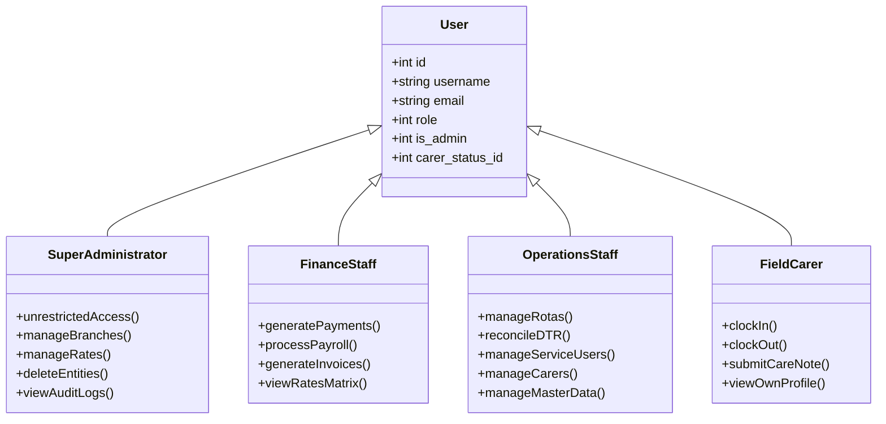

# Mary Care Management System — Software Requirements Specification (SRS)

**Document File:** `docs/02-software-requirements-specification.md`  
**Standard Reference:** IEEE 830-1998 / ISO/IEC/IEEE 29148:2018 Adapted  
**Target Audience:** Product Owners, Business Analysts, System Architects, QA Engineers, Developers  
**Release Version:** 1.0.0 Production  
**Date:** October 2026  

---

## 1. Introduction

### 1.1 Purpose
This Software Requirements Specification (SRS) establishes the complete functional and non-functional requirements for the **Mary Care Management System**. It specifies the exact behaviors, business rules, regulatory mandates, and system boundaries implemented across both the FastAPI backend and Vue 3 / Element Plus frontend.

### 1.2 Scope
The software governs all aspects of domiciliary care operations:
- Identity management and Role-Based Access Control (RBAC).
- Client (Service User) registration, clinical assessments, and Next of Kin records.
- Care staff onboarding, employment types, DBS vetting, and status lifecycles.
- Care rota planning, shift patterns, and recurrence automation.
- Electronic Care Monitoring (ECM), GPS attendance recording, and clinical care notes.
- Daily Time Record (DTR) reconciliation, pay calculation, and invoice batching.
- UK GDPR Article 9 audit trail logging and Article 15 Subject Access Request (SAR) package compilation.

---

## 2. Overall Description

### 2.1 User Roles & Personas

1. **Super Administrator (Role 1, `is_admin: 1`):** Executive decision-maker. Unrestricted authority over organizational branches, financial tariffs, user deactivation/erasure, and regulatory audit investigations.
2. **Finance Staff (Role 2, `is_admin: 1`):** Financial coordinator. Responsible for processing carer payroll, issuing client/funder invoices, generating transaction reports, and cross-checking rates.
3. **Operations Staff (Role 2, `is_admin: 0`):** Care coordinator. Manages rota scheduling, client profiles, staff records, timesheet reconciliation, and agency reference data. Blocked from finance and audit modules.
4. **Field Carer (Role 3, `is_admin: 0`):** Frontline care assistant. Mobile-first user logging arrival and departure times, recording medication prompts, and submitting clinical visit notes. Strictly isolated from all administrative screens.
5. **Public / Unauthenticated (Role 4):** External user interacting exclusively with login, password recovery, and statutory privacy policy pages.

---

## 3. Functional Requirements

### FR-01: Authentication & Account Security
- **FR-01.1:** System shall authenticate users via unique username or registered email address paired with a bcrypt-hashed password.
- **FR-01.2:** System shall enforce a minimum password length of 8 characters containing mixed-case alphanumeric characters and special symbols.
- **FR-01.3:** System shall reject login attempts from accounts with `carer_status_id == 5` (Suspended) with HTTP 403 Forbidden.
- **FR-01.4:** System shall reject login attempts from soft-deleted accounts (`deleted_at IS NOT NULL`) with HTTP 403 Forbidden.
- **FR-01.5:** System shall issue a secure bearer token upon successful authentication and return a serialized profile containing real numeric `role` and `is_admin` flags.
- **FR-01.6:** System shall provide self-service password recovery via secure, time-limited (60-minute expiry) reset tokens dispatched to the user's verified email.

### FR-02: Role-Based Access Control (RBAC)
- **FR-02.1:** Super Administrators shall have unrestricted access to all endpoints, pages, action buttons, and modules.
- **FR-02.2:** Non-administrator users attempting to access unauthorized endpoints shall receive HTTP 403 Forbidden.
- **FR-02.3:** Frontend router shall intercept unauthorized navigation attempts and redirect the user to `/access-denied`.
- **FR-02.4:** Frontend navigation menus shall dynamically hide all links and modules to which the authenticated user lacks permissions.
- **FR-02.5:** Action buttons for high-privilege operations (e.g., Delete Carer, Delete Client, DTR Reset, Branch Edit, Rate Edit) shall be hidden or disabled for non-administrators.

### FR-03: Care Rota Planning & Scheduling
- **FR-03.1:** System shall provide an interactive calendar canvas for assigning care visits between active Service Users and active Carers.
- **FR-03.2:** System shall prevent double-booking a carer for overlapping visit intervals unless explicitly marked as a joint/double-up call.
- **FR-03.3:** System shall support recurring shift generation across weekly, bi-weekly, or monthly intervals.
- **FR-03.4:** System shall validate carer gender requirements against service user preferences before confirming visit allocations.

### FR-04: Electronic Care Monitoring (ECM) & Carer Portal
- **FR-04.1:** Carer Portal shall present field carers with their scheduled visits for the current day.
- **FR-04.2:** System shall allow carers to record a Clock-In timestamp (`time_in`) upon arrival at the client residence.
- **FR-04.3:** System shall capture latitude and longitude coordinates upon Clock-In and compute distance variance against the client's registered coordinates using Haversine calculation.
- **FR-04.4:** System shall allow carers to record a Clock-Out timestamp (`time_out`) upon visit completion.
- **FR-04.5:** Field carers shall be restricted strictly to recording and viewing attendance records assigned to their own user ID.

### FR-05: Clinical Care Notes & PDF Generation
- **FR-05.1:** Carers shall be able to record structured visit outcomes, including tasks completed, personal care provided, nutrition/hydration logs, and medication prompts.
- **FR-05.2:** System shall provide template-driven and automated Care Note synthesis adhering to UK CQC documentation standards.
- **FR-05.3:** System shall generate official, tamper-evident Care Note PDF summaries styled with NHS Blue header badges, client details, shift timestamps, and carer signatures via WeasyPrint.

### FR-06: Daily Time Record (DTR) Reconciliation
- **FR-06.1:** System shall aggregate planned shift hours against actual ECM clock-in/out timestamps within a selectable date range.
- **FR-06.2:** Coordinators shall have the capability to manually input timesheet adjustments with audit rationale.
- **FR-06.3:** Coordinators shall be able to import external timesheet spreadsheets in Excel format.
- **FR-06.4:** Super Administrators alone shall have permission to invoke "Reset Attendance" or "Generate Automatic Times".

### FR-07: Finance, Payroll & Invoicing
- **FR-07.1:** System shall maintain a master cross-product matrix of Active Clients x Shift Codes x Rates defining both `rate` (Carer pay per hour) and `invoice` (Client charge per hour).
- **FR-07.2:** Modifications to the Service User Rates matrix shall strictly require Super Administrator authorization.
- **FR-07.3:** System shall batch completed transactions into Payroll periods and mark them as finalized to prevent duplicate payments.
- **FR-07.4:** System shall batch completed transactions into Client/Commissioner Invoices with itemized shift breakdowns and total balances.

### FR-08: Service User (Client) Management
- **FR-08.1:** System shall store client demographics, date of birth, NHS number, primary address, contact numbers, and Next of Kin (NOK) emergency contacts.
- **FR-08.2:** System shall store special category medical conditions, allergies, mobility requirements, and assigned General Practitioner (GP) details.
- **FR-08.3:** Client deletion shall be restricted strictly to Super Administrators and implemented via soft-delete (`deleted_at`).

### FR-09: Carer (Staff) Management
- **FR-09.1:** System shall manage staff profiles, employment types (Full-Time, Part-Time, Zero-Hours), contact details, and DBS clearance status.
- **FR-09.2:** System shall track mandatory training courses, certifications, and renewal expiry dates.
- **FR-09.3:** Carer deletion shall be restricted strictly to Super Administrators and implemented via soft-delete (`deleted_at`).

### FR-10: Master Data Catalogs
- **FR-10.1:** System shall manage 28 organizational reference catalogs: Branches, Care Types, Shift Codes, Medical Conditions, Condition Categories, GP Practices, NHS Commissioners, Pension Schemes, Marital Statuses, Nationalities, Religions, Kinship Relations, Genders, and Employment Requirements.
- **FR-10.2:** Agency Branches creation, modification, and deletion shall be restricted strictly to Super Administrators.
- **FR-10.3:** Standard catalog management shall be accessible to Operations and Finance Staff.

### FR-11: UK GDPR Article 9 Special Category Audit Logging
- **FR-11.1:** System shall automatically write an immutable audit log to `m_audit_logs` whenever staff access, view, or export client medical records or clinical dossiers.
- **FR-11.2:** Each audit entry shall record `user_id`, `username`, `su_id`, `patient_name`, `record_type`, `action`, client IP address, and browser user-agent.
- **FR-11.3:** Audit log viewing shall be restricted strictly to Super Administrators.

### FR-12: UK GDPR Article 15 Subject Access Request (SAR) Dossier Export
- **FR-12.1:** System shall provide a one-click statutory disclosure engine compiling a data subject's full profile, care shifts, attendance history, care notes, and audit logs.
- **FR-12.2:** System shall export the compiled dossier into a structured, multi-tab Excel file compliant with Article 20 data portability standards.

---

## 4. Non-Functional Requirements (NFRs)

### NFR-01: Performance & Concurrency
- **NFR-01.1:** API endpoints shall respond in under 200 ms for standard CRUD operations under 100 concurrent requests.
- **NFR-01.2:** Care Notes PDF generation shall complete in under 1.5 seconds.
- **NFR-01.3:** Asynchronous database connection pooling shall maintain a minimum of 10 and a maximum of 30 active connections per worker.

### NFR-02: Security & Privacy
- **NFR-02.1:** All communication across public networks must use TLS 1.3 (HTTPS / WSS).
- **NFR-02.2:** Passwords must be hashed using bcrypt with an algorithm work factor of 12.
- **NFR-02.3:** API tokens must expire after 7 days of inactivity.
- **NFR-02.4:** Database records must never be permanently deleted from disk during routine operations; all deletions must use soft-delete (`deleted_at IS NOT NULL`).

### NFR-03: Reliability & Availability
- **NFR-03.1:** The production system shall target an uptime of 99.9% excluding scheduled maintenance windows.
- **NFR-03.2:** System services must automatically restart upon unexpected termination via systemd / Docker restart policies (`restart: unless-stopped`).

### NFR-04: Usability & Accessibility
- **NFR-04.1:** The user interface must support responsive screen resolutions from mobile smartphones (375px width) to widescreen desktop monitors (1920px+).
- **NFR-04.2:** Form inputs must display clear, inline validation error messages.
- **NFR-04.3:** System shall support dark and light visual modes to accommodate low-light working conditions.

---

## 5. Business Rules & Validation Constraints

| Rule ID | Domain | Business Rule / Validation Constraint |
| :--- | :--- | :--- |
| **BR-01** | **Shift Time Bounds** | Visit start time must strictly precede visit end time. Overnight shifts spanning midnight must carry distinct calendar dates. |
| **BR-02** | **NHS Number Format** | UK NHS numbers must adhere to the 10-digit format (3-3-4 pattern: `XXX XXX XXXX`) and satisfy Modulus 11 check digit verification. |
| **BR-03** | **DBS Expiry Warning** | Carer records with DBS clearance expiring within 30 days must trigger automated visual badges in coordinator views. |
| **BR-04** | **Rate Matrix Uniqueness** | The combination of `(su_id, shift_id)` in `m_service_user_rates` must be unique. Upsert logic applies when updating. |
| **BR-05** | **SAR Export Timeline** | Article 15 Subject Access Requests must be compiled within statutory 30 calendar days of receipt. |
| **BR-06** | **Attendance Geofence** | GPS variance exceeding 500 meters from registered client coordinates flags an audit notification on the visit log. |
| **BR-07** | **Payroll Finalization** | Shift transactions marked with a non-null `payroll` ID are locked from further automated payment batching. |
