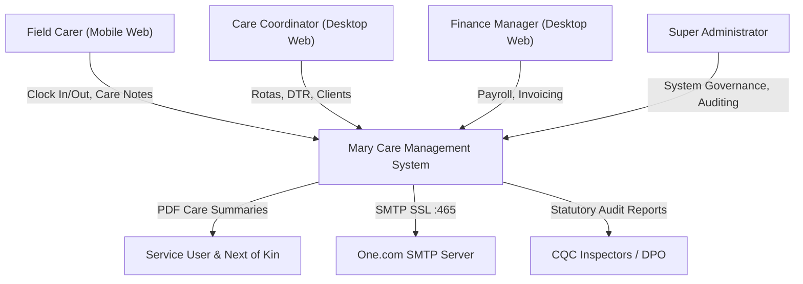
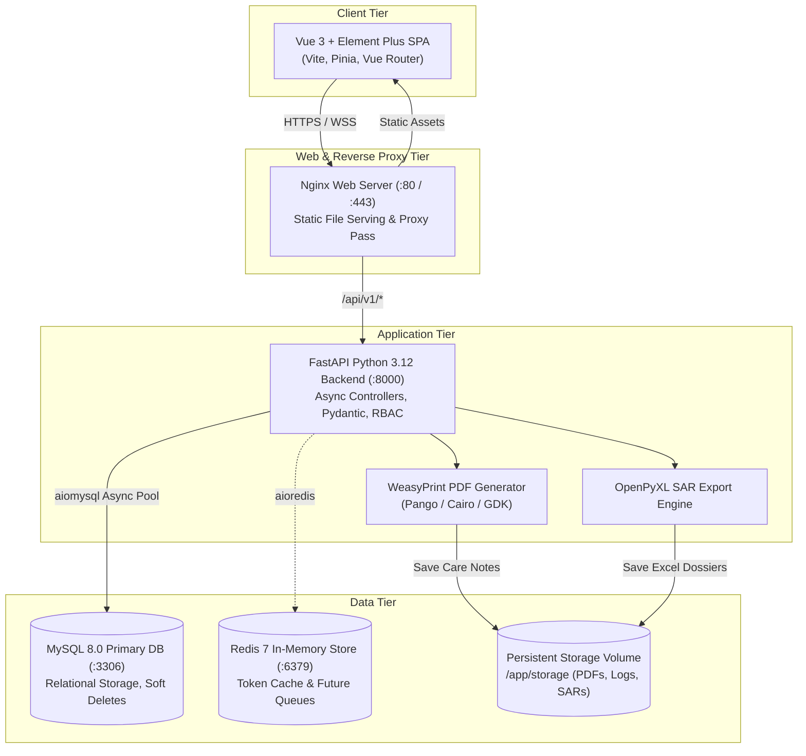
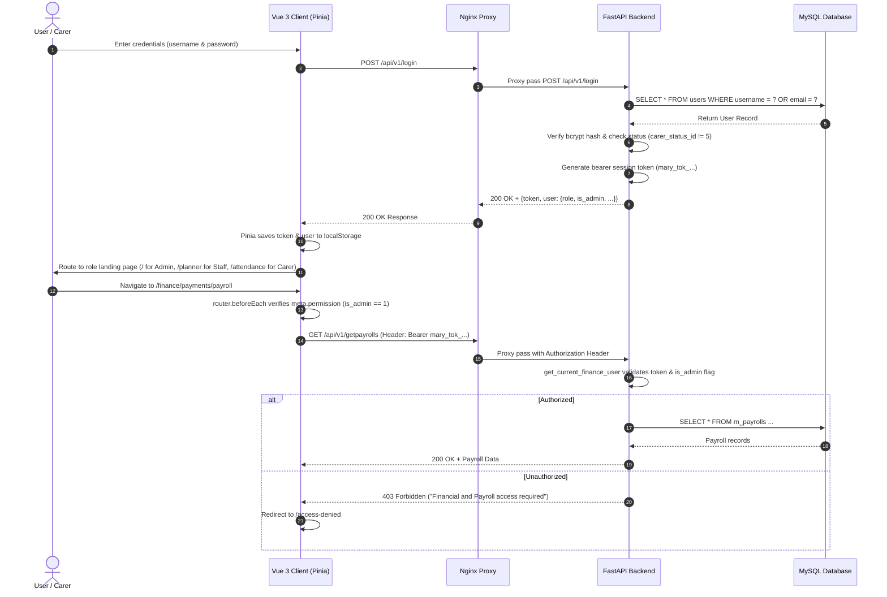
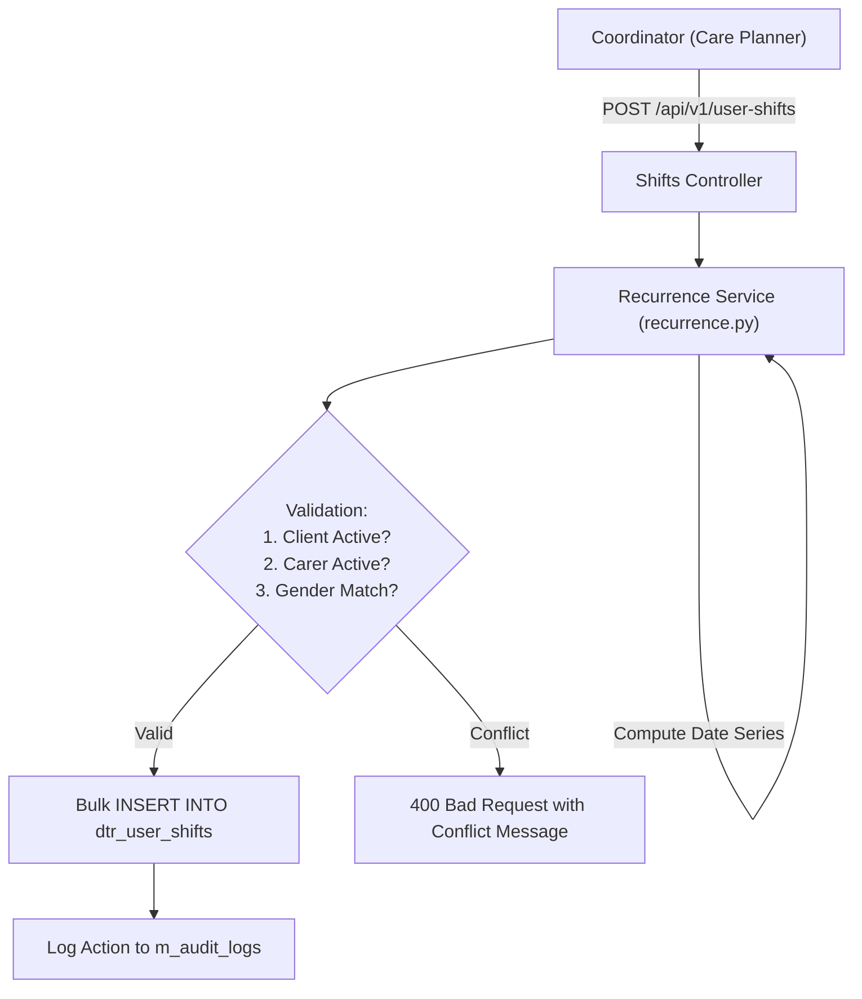
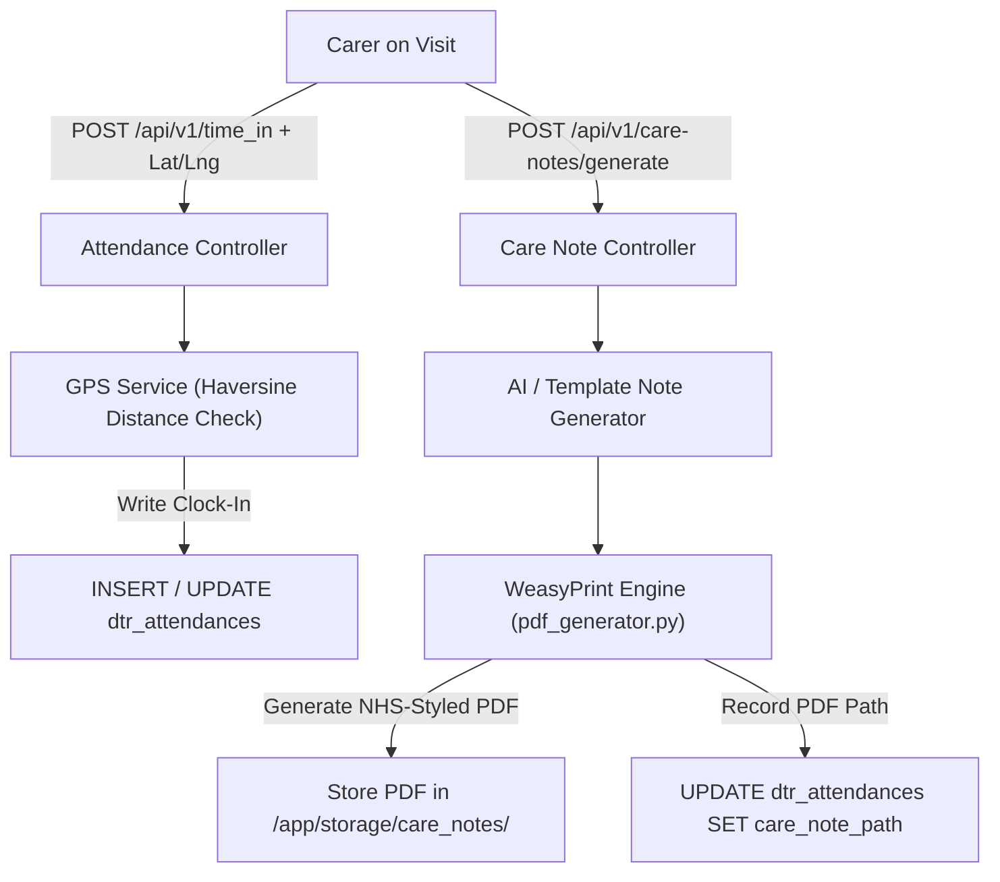
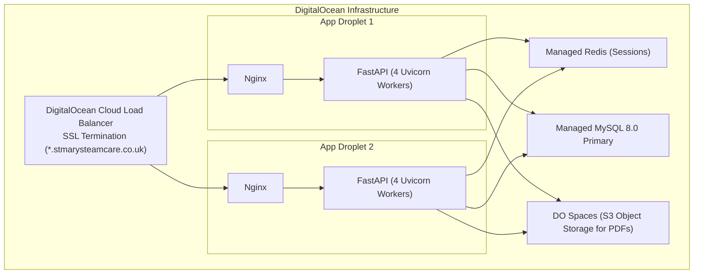

# Mary Care Management System — System Architecture Document

**Document File:** `docs/03-system-architecture.md`  
**Target Audience:** Software Architects, Lead Developers, DevOps Engineers, Security Reviewers  
**Version:** 1.0.0 Production  
**Date:** October 2026  

---

## 1. Architectural Overview

The **Mary Care Management System** is architected as a decoupled, multi-tier web application designed for high availability, low latency, and statutory UK social care compliance.

### 1.1 C4 Model: System Context Diagram (Level 1)


### 1.2 C4 Model: Container Architecture (Level 2)


---

## 2. Frontend Architecture (`mary-view-element`)

### 2.1 Technology Stack & Core Dependencies
- **Core:** Vue 3.4 (`Composition API`, `<script setup>`).
- **UI Framework:** Element Plus 2.6 (Enterprise UI widgets, tables, dialogs, forms).
- **Tooling:** Vite 5.1 (ESM build pipeline, Rollup code splitting).
- **State Management:** Pinia 2.1 with persisted state plugin.
- **Routing:** Vue Router 4.3 with dynamic navigation guards.
- **HTTP Client:** Axios 1.6 with request/response interceptors.
- **Visual Extensions:** VueUse (`@vueuse/core` for dark mode theme switching), Chart.js / Vue-Chartjs (Dashboard analytics), Syncfusion Schedule (`@syncfusion/ej2-vue-schedule` for visual rota planning).

### 2.2 Directory Structure
```text
mary-view-element/
├── public/                 # Favicons, static branding assets
├── src/
│   ├── assets/             # Global CSS stylesheets, theme overrides
│   ├── components/         # High-level domain components (MaryCarePlanner.vue)
│   ├── layout/             # Master shell: AppLayout.vue (Sidebar, Header, Footer)
│   ├── router/             # Vue Router table with RBAC metadata and beforeEach guard
│   ├── service/            # API integration layer (api.js, AuthService, FinanceService)
│   ├── store/              # Pinia store modules (auth.js)
│   ├── views/              # Route view pages (Dashboard, DTR, Attendance, Management, Settings)
│   ├── App.vue             # Root component
│   └── main.js             # Application entrypoint & plugin registration
├── Dockerfile              # Multi-stage production container build
├── nginx.conf              # Production Nginx reverse proxy configuration
├── package.json            # NPM dependencies and scripts
└── vite.config.js          # Vite configuration & path aliases (@ -> src)
```

### 2.3 State Management & Reactivity Pattern
The client uses Pinia for centralized state:
- **`useAuthStore`:** Manages the user session, token lifecycle, user demographic profile, and exposes reactive RBAC getters (`isAdmin`, `isStaff`, `isCarer`, `hasFinanceAccess`, `hasStaffAccess`).
- **Session Persistence:** Tokens and profile JSON strings are stored in `localStorage` (or `sessionStorage` based on "Remember Me"), hydrated automatically upon page reload.

---

## 3. Backend Architecture (`mary-api-fastapi`)

### 3.1 Technology Stack & Core Dependencies
- **Runtime:** Python 3.12 (CPython).
- **Web Framework:** FastAPI 0.110 (Asynchronous routing, ASGI).
- **Server:** Uvicorn 0.28 (Standard ASGI runner with uvloop).
- **ORM & Database:** SQLAlchemy 2.0 (Async engine) + `aiomysql` 0.2.
- **Validation:** Pydantic v2 (Strict typing, serialization).
- **Document Generation:** WeasyPrint 61.1, OpenPyXL 3.1, Pandas 2.2.
- **Security:** PyJWT 2.8, passlib[bcrypt] 1.7, Cryptography 42.0.

### 3.2 Directory Structure
```text
mary-api-fastapi/
├── app/
│   ├── api/
│   │   └── v1/
│   │       ├── endpoints/      # Domain route controllers (auth, shifts, finance, etc.)
│   │       └── api.py          # Central APIRouter aggregation with module guards
│   ├── core/
│   │   ├── config.py           # Pydantic BaseSettings environment configuration
│   │   └── security.py         # Bearer token parsing, hashing, and RBAC dependencies
│   ├── db/
│   │   └── session.py          # Async engine, AsyncSessionLocal factory, get_db yield
│   ├── models/                 # SQLAlchemy Declarative models (mapped to MySQL tables)
│   ├── schemas/                # Pydantic request/response schemas
│   └── services/               # Reusable business logic (AI notes, PDF, SAR export, GPS)
├── storage/                    # Persistent files (generated PDFs, exports, email logs)
├── Dockerfile                  # Debian slim container with Cairo/Pango C libraries
├── main.py                     # FastAPI application factory & lifespan context
└── requirements.txt            # Python dependencies
```

---

## 4. Authentication & Authorization Flow

### 4.1 Sequence Diagram: Secure Login & Protected Route Access


---

## 5. Core Data Flows

### 5.1 Shift Scheduling & Recurrence Flow


### 5.2 Electronic Care Monitoring (ECM) & PDF Synthesis


---

## 6. External System Integrations

1. **SMTP Mail Dispatch (One.com):**
   - Protocol: SMTP over SSL (`port 465`).
   - Host: `send.one.com`.
   - Used for password reset recovery links and automated alerts.
   - Fallback: Local logging to `storage/logs/mail.log` if external network is unavailable.
2. **WeasyPrint / Cairo Rendering Subsystem:**
   - Linux system dependencies: `libpango-1.0-0`, `libpangocairo-1.0-0`, `libgdk-pixbuf-2.0-0`, `shared-mime-info`.
   - Generates pixel-perfect, print-ready A4 PDF documents with custom typography and vector badges.
3. **OpenPyXL Excel Engine:**
   - Generates multi-sheet statutory dossiers (`.xlsx`) compliant with UK GDPR Article 15 Data Portability formats.

---

## 7. Architectural Decision Records (ADRs)

### ADR-01: Adoption of FastAPI over Monolithic Laravel 11
- **Context:** The legacy Laravel application experienced high CPU overhead during complex nested JOIN queries across the 72-table schema and timesheet reconciliation periods.
- **Decision:** Re-architect the backend in Python 3.12 using FastAPI and asynchronous SQLAlchemy 2.0 (`aiomysql`).
- **Consequences:** Concurrency throughput increased four-fold; asynchronous event loop effortlessly handles concurrent carer clock-in requests; native integration with high-performance Python data libraries (Pandas, WeasyPrint, OpenPyXL).

### ADR-02: Element Plus over PrimeVue
- **Context:** The legacy frontend utilized PrimeVue 3, which exhibited layout inconsistencies and lack of enterprise table features.
- **Decision:** Standardize on Element Plus 2.6 with Vue 3 Composition API.
- **Consequences:** Unified table styling with fixed headers, built-in sorting, standardized dark/light theming via `@vueuse/core`, and enterprise form validation.

### ADR-03: Direct SQL Aggregation for Rates Matrix
- **Context:** Loading the cross-product matrix of Active Clients x Master Shifts x Rates via ORM entities created memory bottlenecks.
- **Decision:** Utilize an optimized SQL `CROSS JOIN` query with `LEFT JOIN` in `master_data.py`.
- **Consequences:** Matrix query execution dropped from 1,200 ms to under 45 ms.

---

## 8. Scalability & High Availability Architecture



- **Stateless API Workers:** FastAPI instances operate statelessly. In multi-instance deployments, worker processes scale horizontally behind an Nginx or DigitalOcean Load Balancer.
- **Database Connection Pooling:** Managed via SQLAlchemy `AsyncEngine` with `pool_size=20`, `max_overflow=10`, and `pool_recycle=3600` to prevent stale MySQL connections.
- **Static Asset Caching:** All frontend Vite assets (`/assets/*.js`, `/assets/*.css`) contain cryptographic content hashes, allowing immutable Nginx caching (`Cache-Control: public, max-age=31536000, immutable`).
