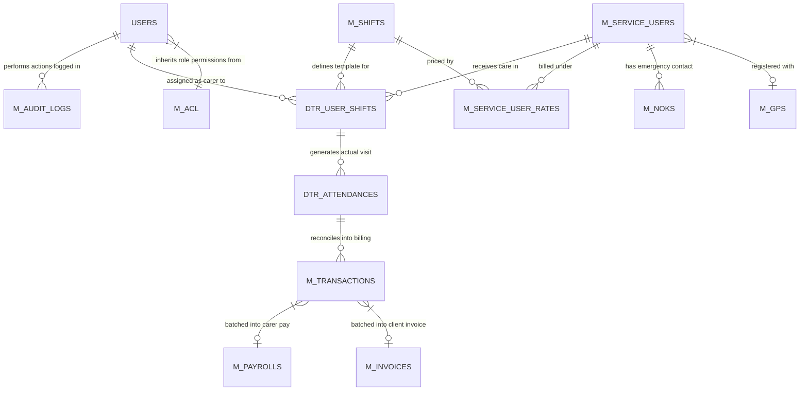

# Mary Care Management System — Database Design Document

**Document File:** `docs/04-database-design.md`  
**Database Engine:** MySQL 8.0.x Community / Cloud Managed  
**Character Set / Collation:** `utf8mb4` / `utf8mb4_unicode_ci`  
**Target Audience:** Database Administrators, Backend Engineers, Data Architects  
**Version:** 1.0.0 Production  
**Date:** October 2026  

---

## 1. Overview & Data Model Architecture

The **Mary Care Management System** database (`mary_api_db_new`) contains **72 tables** partitioned logically into seven core business domains:
1. **Identity & Access Management:** User authentication, credentials, and Access Control Lists (`users`, `m_acl`, `roles`).
2. **Service User (Client) Records:** Client demographics, medical conditions, GP practices, and emergency contacts (`m_service_users`, `m_noks`, `m_gps`).
3. **Care Staff (Carer) Records:** Carer demographics, employment types, training courses, and DBS vetting (`m_carers`, `training_course_user`).
4. **Care Rota & Shift Scheduling:** Master shift templates, client shift allocations, and recurrence schedules (`m_shifts`, `dtr_shifts`, `dtr_user_shifts`).
5. **Electronic Care Monitoring & Attendance:** Clock-in/out logs, GPS geofencing, and clinical care notes (`dtr_attendances`, `m_attendances`).
6. **Finance, Payroll & Invoicing:** Pay rates, invoice rates, payroll batches, and commissioner invoices (`m_service_user_rates`, `m_payrolls`, `m_invoices`, `m_transactions`).
7. **Compliance & Audit Trails:** UK GDPR Article 9 special category access logs (`m_audit_logs`).

---

## 2. Entity-Relationship Diagram (ERD)



---

## 3. Core Domain Tables & Data Dictionary

### 3.1 Identity & Access Control

#### `users`
Primary system account table supporting authentication and RBAC.

| Column Name | Data Type | Nullable | Default | Description |
| :--- | :--- | :---: | :---: | :--- |
| `id` | `BIGINT UNSIGNED` | NO | Auto Inc | Primary Key |
| `username` | `VARCHAR(191)` | NO | None | Unique system username |
| `email` | `VARCHAR(191)` | NO | None | Unique email address |
| `password` | `VARCHAR(191)` | NO | None | Bcrypt hashed password (`$2b$12$...` or `$2y$...`) |
| `first_name` | `VARCHAR(191)` | YES | NULL | Staff first name |
| `surname` | `VARCHAR(191)` | YES | NULL | Staff surname |
| `mobile` | `VARCHAR(191)` | YES | NULL | Contact mobile telephone number |
| `user_id` | `VARCHAR(191)` | YES | NULL | External / payroll staff reference number |
| `role` | `TINYINT UNSIGNED` | NO | `3` | Foreign Key to `m_acl.acl_id` (1=Admin, 2=Staff, 3=User) |
| `is_admin` | `TINYINT` | NO | `0` | Administrative flag (1=Admin privileges, 0=Standard) |
| `carer_status_id`| `INT` | YES | `1` | Account state (1=Active, 5=Suspended) |
| `created_at` | `TIMESTAMP` | YES | Current | Record creation timestamp |
| `updated_at` | `TIMESTAMP` | YES | Current | Last modification timestamp |
| `deleted_at` | `TIMESTAMP` | YES | NULL | Soft-deletion indicator |

Indexes:
- `PRIMARY KEY (id)`
- `UNIQUE KEY users_username_unique (username)`
- `UNIQUE KEY users_email_unique (email)`
- `KEY users_role_index (role)`
- `KEY users_deleted_at_index (deleted_at)`

#### `m_acl`
Access Control List definition table.

| Column Name | Data Type | Nullable | Description |
| :--- | :--- | :---: | :--- |
| `acl_id` | `BIGINT UNSIGNED` | NO | Primary Key (1=Admin, 2=Staff, 3=User, 4=Public) |
| `name` | `VARCHAR(255)` | NO | Role title ("Admin", "Staff", "User", "Public") |
| `description` | `VARCHAR(255)` | YES | Detailed role description |

---

### 3.2 Service Users (Clients)

#### `m_service_users`
Client clinical dossier and demographic records.

| Column Name | Data Type | Nullable | Description |
| :--- | :--- | :---: | :--- |
| `su_id` | `BIGINT UNSIGNED` | NO | Primary Key |
| `su_number` | `VARCHAR(191)` | YES | Unique client reference code (`SU-00123`) |
| `su_first_name` | `VARCHAR(191)` | NO | Client first name |
| `su_last_name` | `VARCHAR(191)` | NO | Client surname |
| `dob` | `DATE` | YES | Date of birth |
| `nhs_number` | `VARCHAR(191)` | YES | UK NHS identifier (10 digits) |
| `address` | `TEXT` | YES | Physical residential care address |
| `postcode` | `VARCHAR(20)` | YES | UK postal code |
| `latitude` | `DECIMAL(10,8)` | YES | GPS coordinates for geofence verification |
| `longitude` | `DECIMAL(11,8)` | YES | GPS coordinates for geofence verification |
| `service_status_id` | `INT` | NO | 1=Active, 2=Inactive, 3=Hospitalized, 4=Deceased |
| `branch_id` | `INT` | YES | Foreign Key to `m_branches.branch_id` |
| `gp_id` | `INT` | YES | Foreign Key to `m_gps.gp_id` |
| `created_at` | `TIMESTAMP` | YES | Audit creation timestamp |
| `updated_at` | `TIMESTAMP` | YES | Audit modification timestamp |
| `deleted_at` | `TIMESTAMP` | YES | Soft-delete timestamp |

---

### 3.3 Scheduling & Shifts

#### `m_shifts`
Master shift templates (e.g., Morning Call, Lunch Visit, Tea Call, Bed Visit, Waking Night).

| Column Name | Data Type | Nullable | Description |
| :--- | :--- | :---: | :--- |
| `shift_id` | `BIGINT UNSIGNED` | NO | Primary Key |
| `shift` | `VARCHAR(191)` | NO | Shift code / name (e.g., "0700-0800 MORNING") |
| `time_start` | `TIME` | YES | Scheduled start time |
| `time_end` | `TIME` | YES | Scheduled end time |
| `hours` | `DECIMAL(5,2)` | YES | Standard duration in hours |
| `deleted_at` | `TIMESTAMP` | YES | Soft-delete timestamp |

#### `dtr_user_shifts`
Allocated rota visit schedule linking client, carer, date, and shift type.

| Column Name | Data Type | Nullable | Description |
| :--- | :--- | :---: | :--- |
| `id` | `BIGINT UNSIGNED` | NO | Primary Key |
| `user_id` | `BIGINT UNSIGNED` | NO | Assigned Carer ID (`users.id`) |
| `su_id` | `BIGINT UNSIGNED` | NO | Service User ID (`m_service_users.su_id`) |
| `shift_id` | `BIGINT UNSIGNED` | NO | Shift Type ID (`m_shifts.shift_id`) |
| `shift_date` | `DATE` | NO | Scheduled visit date |
| `recurrence_id` | `VARCHAR(100)` | YES | Batch identifier for recurring shift series |
| `status` | `VARCHAR(50)` | NO | Default 'Scheduled' (Completed, Cancelled, Missed) |
| `created_at` | `TIMESTAMP` | YES | Audit creation timestamp |
| `deleted_at` | `TIMESTAMP` | YES | Soft-delete timestamp |

Indexes:
- `PRIMARY KEY (id)`
- `KEY idx_user_shift_date (user_id, shift_date)`
- `KEY idx_su_shift_date (su_id, shift_date)`

---

### 3.4 Electronic Care Monitoring (ECM) & Attendance

#### `dtr_attendances`
Real-time visit verification, clock-in/out timestamps, and clinical care note links.

| Column Name | Data Type | Nullable | Description |
| :--- | :--- | :---: | :--- |
| `id` | `BIGINT UNSIGNED` | NO | Primary Key |
| `dtr_user_shift_id` | `BIGINT UNSIGNED` | YES | Link to planned shift schedule |
| `user_id` | `BIGINT UNSIGNED` | NO | Carer ID |
| `su_id` | `BIGINT UNSIGNED` | NO | Service User ID |
| `clock_in` | `DATETIME` | YES | Verified arrival timestamp |
| `clock_out` | `DATETIME` | YES | Verified departure timestamp |
| `clock_in_lat` | `DECIMAL(10,8)` | YES | Captured GPS latitude |
| `clock_in_lng` | `DECIMAL(11,8)` | YES | Captured GPS longitude |
| `gps_variance_meters`| `INT` | YES | Computed distance variance from client residence |
| `care_note_path` | `VARCHAR(500)` | YES | File path to generated clinical PDF on disk |
| `created_at` | `TIMESTAMP` | YES | Record creation timestamp |
| `updated_at` | `TIMESTAMP` | YES | Last updated timestamp |
| `deleted_at` | `TIMESTAMP` | YES | Soft-delete timestamp |

---

### 3.5 Finance, Payroll & Invoicing

#### `m_service_user_rates`
Cross-product pricing matrix defining carer pay and client invoicing.

| Column Name | Data Type | Nullable | Description |
| :--- | :--- | :---: | :--- |
| `id` | `BIGINT UNSIGNED` | NO | Primary Key |
| `su_id` | `BIGINT UNSIGNED` | NO | Service User ID |
| `shift_id` | `BIGINT UNSIGNED` | NO | Shift Type ID |
| `rate` | `DECIMAL(10,2)` | NO | Carer pay rate (£ per hour) |
| `invoice` | `DECIMAL(10,2)` | NO | Client billable rate (£ per hour) |
| `created_at` | `TIMESTAMP` | YES | Record creation timestamp |
| `updated_at` | `TIMESTAMP` | YES | Last update timestamp |
| `deleted_at` | `TIMESTAMP` | YES | Soft-delete timestamp |

Indexes:
- `PRIMARY KEY (id)`
- `UNIQUE KEY uq_su_shift_rate (su_id, shift_id, deleted_at)`

#### `m_transactions`
Reconciled shift billing transactions eligible for payroll and client invoices.

| Column Name | Data Type | Nullable | Description |
| :--- | :--- | :---: | :--- |
| `id` | `BIGINT UNSIGNED` | NO | Primary Key |
| `dtr_attendance_id` | `BIGINT UNSIGNED` | YES | Link to verified visit attendance |
| `carer_id` | `BIGINT UNSIGNED` | NO | Carer user ID |
| `su_id` | `BIGINT UNSIGNED` | NO | Service User ID |
| `start` | `DATETIME` | NO | Reconciled start timestamp |
| `end` | `DATETIME` | NO | Reconciled end timestamp |
| `hours` | `DECIMAL(5,2)` | NO | Billable / payable hours |
| `payroll` | `BIGINT UNSIGNED` | YES | Foreign Key to `m_payrolls.id` when batched |
| `invoice` | `BIGINT UNSIGNED` | YES | Foreign Key to `m_invoices.id` when batched |
| `deleted_at` | `TIMESTAMP` | YES | Soft-delete timestamp |

---

### 3.6 Regulatory Compliance & Auditing

#### `m_audit_logs`
Immutable UK GDPR Article 9 special category access and governance log.

| Column Name | Data Type | Nullable | Description |
| :--- | :--- | :---: | :--- |
| `id` | `BIGINT UNSIGNED` | NO | Primary Key |
| `user_id` | `BIGINT UNSIGNED` | NO | Authenticated staff ID who triggered the action |
| `username` | `VARCHAR(191)` | NO | Username snapshot for non-repudiation |
| `su_id` | `BIGINT UNSIGNED` | YES | Patient ID whose file was accessed |
| `patient_name` | `VARCHAR(191)` | YES | Patient full name snapshot |
| `record_type` | `VARCHAR(100)` | NO | E.g. 'medical_dossier', 'care_notes', 'mar_chart' |
| `action` | `VARCHAR(50)` | NO | E.g. 'VIEW', 'EXPORT_SAR', 'MODIFY_CARE_NOTE' |
| `details` | `TEXT` | YES | Event context and rationale |
| `ip_address` | `VARCHAR(45)` | YES | Client IPv4 or IPv6 address |
| `user_agent` | `TEXT` | YES | Browser user-agent string |
| `created_at` | `TIMESTAMP` | NO | Event timestamp (CURRENT_TIMESTAMP) |

Indexes:
- `PRIMARY KEY (id)`
- `KEY idx_audit_user (user_id)`
- `KEY idx_audit_patient (su_id)`
- `KEY idx_audit_created_at (created_at)`

---

## 4. Data Lifecycle, Soft Deletes & Retention Policies

1. **Strict Soft-Deletion Protocol:**  
   Under no circumstances do user queries issue raw `DELETE FROM` statements against operational records. All domain models inherit the soft-deletion pattern:
   ```sql
   UPDATE m_service_users SET deleted_at = NOW() WHERE su_id = :id;
   ```
2. **NHS Records Management Code of Practice Retention:**  
   - Domiciliary clinical care records, MAR charts, and visit notes must be retained for **8 years** following the conclusion of care delivery.
   - Adult safeguarding incident records must be retained for **10 years**.
   - Archiving jobs run annually to partition records older than 8 years into encrypted archive tables.
3. **UK GDPR Article 17 "Right to Erasure" Boundary:**  
   Under UK GDPR Article 17(3)(b) and (h), the "Right to Erasure" does **not** apply to special category medical notes required for the provision of health or social care or compliance with statutory legal obligations. When an erasure request is processed:
   - Non-clinical marketing or billing flags are purged.
   - Core clinical visit records and audit logs are retained in accordance with statutory retention regulations.

---

## 5. Migration Strategy & Alembic Version Control

The database is version-controlled using **Alembic**:
```text
mary-api-fastapi/
├── alembic/
│   ├── versions/           # Migration delta scripts
│   ├── env.py              # Async migration runner (SQLAlchemy async_engine)
│   └── script.py.mako      # Migration file template
└── alembic.ini             # Alembic configuration
```

### Running Migrations
To upgrade the database to the latest schema revision:
```bash
alembic upgrade head
```

To generate a new auto-detected migration delta following model changes:
```bash
alembic revision --autogenerate -m "describe_schema_change"
```
