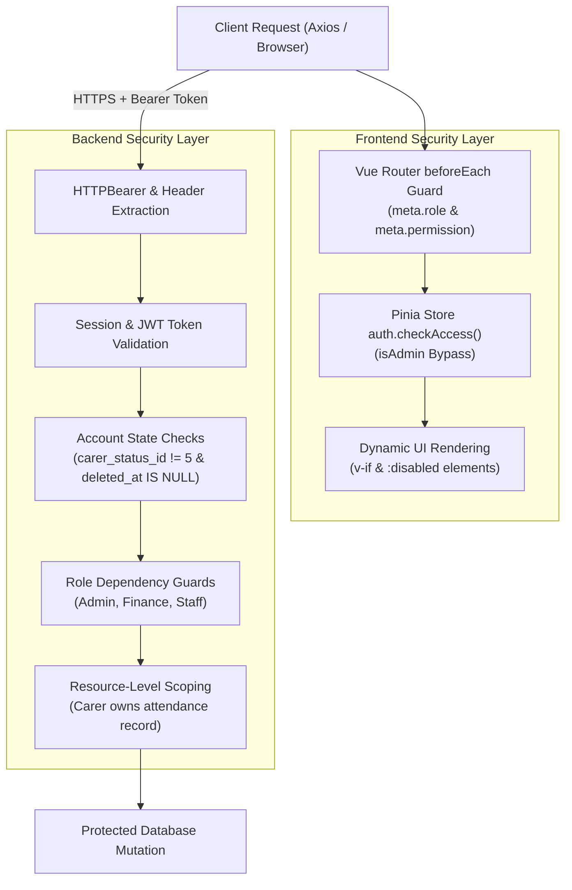
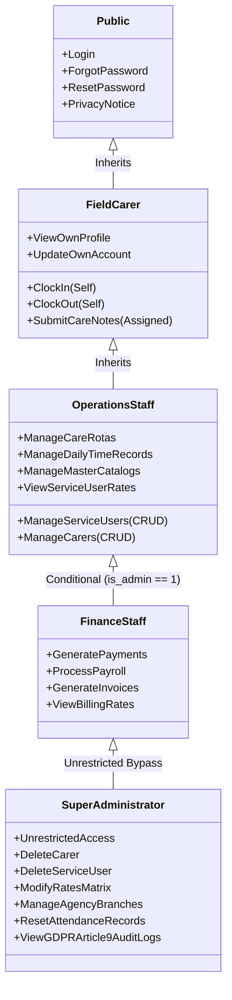

# Mary Care Management System — Role-Based Access Control (RBAC) & Security Model

**Document File:** `docs/06-rbac-security-model.md`  
**Security Framework:** Principle of Least Privilege (PoLP) & Defense-in-Depth  
**Reference Parity:** Legacy Laravel 11 (`m_acl`, Model Policies) vs FastAPI Python 3.12  
**Target Audience:** Information Security Officers, Architects, Auditing Bodies, Backend Engineers  
**Version:** 1.0.0 Production  
**Date:** October 2026  

---

## 1. Security Architecture & Threat Boundary

In healthcare and domiciliary social care operations, data confidentiality is governed by strict UK statutory standards (**UK GDPR**, **Data Protection Act 2018**, and **NHS Data Security & Protection Toolkit**). The Mary Care Management System enforces multi-layered access control where unauthorized users are blocked at both the presentation layer (UI) and the API transport layer (FastAPI).



---

## 2. Role Taxonomy & Inheritance Model

The system organizes permissions into four core system roles derived from `m_acl` and modulated by the `users.is_admin` boolean flag:



### 2.1 Role Definitions

| Role ID | Role Code | Role Name | System Purpose & Boundary |
| :---: | :---: | :---: | :--- |
| **1** | `1` | **Super Administrator** | **Unrestricted Access:** Highest privilege level. Unrestricted access to all backend routes, administrative functions, rate matrices, branches, entity deletions, and audit trails. |
| **2** | `2` (`is_admin: 1`) | **Finance Staff** | **Financial & Operations Management:** Operational coordination plus financial billing modules (Payments, Payroll, Invoicing). |
| **2** | `2` (`is_admin: 0`) | **Operations Staff** | **Operations Only:** Shift planning, DTR reconciliation, staff onboarding, client registration, and master data. Strictly blocked from financial and audit data. |
| **3** | `3` (`is_admin: 0`) | **Field Carer** | **Carer Portal Only:** Frontline mobile portal restricted strictly to personal visit logs, clocking in/out, clinical care notes, and profile settings. |
| **4** | `4` | **Public Guest** | Unauthenticated routes (`/login`, `/reset-password`, `/privacy-policy`). |

---

## 3. Comprehensive Role-to-Feature Access Matrix

| System Module / Capability | Super Admin (`1`, `admin: 1`) | Finance Staff (`2`, `admin: 1`) | Operations Staff (`2`, `admin: 0`) | Field Carer (`3`, `admin: 0`) | Public (`4`) |
| :--- | :---: | :---: | :---: | :---: | :---: |
| **Executive Dashboard** (`/`) | **Allowed** | **Allowed** | Forbidden (403) | Forbidden (403) | Blocked (401) |
| **Article 9 Audit Trail** (`/audit-logs`) | **Allowed** | **Allowed** | Forbidden (403) | Forbidden (403) | Blocked (401) |
| **Care Rota Planner** (`/planner`) | **Allowed** | **Allowed** | **Allowed** | Forbidden (403) | Blocked (401) |
| **Daily Time Record (DTR)** (`/dtr`) | **Allowed** | **Allowed** | **Allowed** | Forbidden (403) | Blocked (401) |
| **DTR Reset Row & Auto-Times** | **Allowed** | Forbidden (403) | Forbidden (403) | Forbidden (403) | Blocked (401) |
| **Generate Payments** (`/payments`) | **Allowed** | **Allowed** | Forbidden (403) | Forbidden (403) | Blocked (401) |
| **Payroll Management** (`/payroll`) | **Allowed** | **Allowed** | Forbidden (403) | Forbidden (403) | Blocked (401) |
| **Invoice Management** (`/invoice`) | **Allowed** | **Allowed** | Forbidden (403) | Forbidden (403) | Blocked (401) |
| **Carers Directory** (`/management/carers`)| **Allowed** | **Allowed** | **Allowed** | Forbidden (403) | Blocked (401) |
| **Carer Staff Deletion** (`DELETE /carers`)| **Allowed** | Forbidden (403) | Forbidden (403) | Forbidden (403) | Blocked (401) |
| **Service Users Management** | **Allowed** | **Allowed** | **Allowed** | Forbidden (403) | Blocked (401) |
| **Service User Deletion** | **Allowed** | Forbidden (403) | Forbidden (403) | Forbidden (403) | Blocked (401) |
| **Article 15 SAR Export** | **Allowed** | **Allowed** | **Allowed** | Forbidden (403) | Blocked (401) |
| **Standard Master Settings (20+ Catalogs)**| **Allowed** | **Allowed** | **Allowed** | Forbidden (403) | Blocked (401) |
| **Agency Branches (Create/Update/Delete)** | **Allowed** | Forbidden (403) | Forbidden (403) | Forbidden (403) | Blocked (401) |
| **Service User Rates (Modify)** | **Allowed** | Forbidden (403) | Forbidden (403) | Forbidden (403) | Blocked (401) |
| **Service User Rates (View)** | **Allowed** | **Allowed** | **Allowed** | Forbidden (403) | Blocked (401) |
| **Carer Attendance Portal** (`/attendance`) | **Allowed** | **Allowed** | **Allowed** | **Allowed (Self)** | Blocked (401) |
| **Personal Account Profile** (`/account`) | **Allowed** | **Allowed** | **Allowed** | **Allowed (Self)** | Blocked (401) |

---

## 4. Backend Authorization Implementation

Backend authorization relies on FastAPI's Dependency Injection pattern in [`app/core/security.py`](file:///c:/Projects/Mary/mary-api-fastapi/app/core/security.py):

### 4.1 Dependency Guards
1. **`get_current_active_user`:**
   - Validates bearer token format (`mary_tok_...` or JWT).
   - Confirms user existence in database.
   - Enforces account deactivation check: `if user.deleted_at is not None: raise 403`.
   - Enforces account suspension check: `if user.carer_status_id == 5: raise 403`.
2. **`get_current_admin_user`:**
   - Enforces: `is_admin_user(user)` &rarr; `user.is_admin == 1 or user.role == 1`.
   - Fails with: `403 Forbidden ("Administrator access required")`.
3. **`get_current_staff_user`:**
   - Enforces: `is_staff_user(user)` &rarr; `is_admin_user(user) or user.role in (1, 2)`.
   - Fails with: `403 Forbidden ("Staff or Administrator access required")`.
4. **`get_current_finance_user`:**
   - Enforces: `has_finance_access(user)` &rarr; `is_admin_user(user) or (user.role in (1, 2) and user.is_admin == 1)`.
   - Fails with: `403 Forbidden ("Financial and Payroll administrative access required")`.

### 4.2 Resource-Level Ownership Scoping
On attendance endpoints (`time_in`, `time_out`), non-staff carers (`role: 3`) are strictly bound to their authenticated token identity:
```python
if current_user.role == 3:
    if payload.get("user_id") != current_user.id:
        raise HTTPException(
            status_code=403,
            detail="Carers are only authorized to log attendance for their own assigned visits."
        )
```

---

## 5. Frontend Authorization Implementation

### 5.1 Route Navigation Guards ([`src/router/index.js`](file:///c:/Projects/Mary/mary-view-element/src/router/index.js))
Each route declares its required roles and administrative flags via `meta`:
```javascript
{
  path: 'payroll',
  name: 'Payroll',
  component: () => import('@/views/MaryPayroll.vue'),
  meta: { title: 'Payroll Management', role: [1, 2], permission: [1] }
}
```

The global guard intercepts transitions before components render:
```javascript
router.beforeEach(async (to, from, next) => {
  // 1. Session verification & public bypass
  ...
  // 2. Administrators bypass all checks
  if (authStore.isAdmin) return next()

  // 3. Evaluate required roles & permissions
  const requiredRoles = to.meta?.role
  const requiredPermissions = to.meta?.permission

  if (requiredRoles || requiredPermissions) {
    const hasAccess = authStore.checkAccess(requiredRoles, requiredPermissions)
    if (!hasAccess) {
      return next('/access-denied')
    }
  }
  next()
})
```

### 5.2 Dynamic Interface Elements
- **Navigation Sidebar:** `<el-menu-item index="/" v-if="authStore.isAdmin">`, `<el-sub-menu index="finance" v-if="authStore.hasFinanceAccess">`.
- **Action Buttons:** Delete buttons in `CarersView` and `ServiceUsersView` carry `v-if="authStore.isAdmin"`.
- **Form Controls:** Carer rate and client invoice inputs in `SettingsRates.vue` carry `:disabled="!authStore.isAdmin"`.

---

## 6. Legacy Implementation Parity Comparison

| Policy Domain | Legacy Laravel Mechanism | Modern FastAPI / Element Plus Equivalent | Parity Result |
| :--- | :--- | :--- | :---: |
| **Admin Privilege** | `$user->role === 1` or `$user->is_Admin` bypass | `authStore.isAdmin` & `is_admin_user()` bypass | **Identical** |
| **Finance Access** | `MenuBar.vue` checks `permission: [1]` (`is_admin`) | `hasFinanceAccess` checks `(role in 1,2 && is_admin==1)` | **Identical** |
| **Agency Branches** | `MBranchesPolicy.php` checks `$user->role === 1` | `get_current_admin_user` on `POST/PUT/DELETE /branches` | **Identical** |
| **Service Rates** | `MServiceUserRatesPolicy` checks `$user->is_Admin` | `get_current_admin_user` on `POST /savesurate` | **Identical** |
| **DTR Clock Reset** | `MManualDTRController` checks `$user->is_Admin == 1` | `get_current_admin_user` on `POST /attendances/reset` | **Identical** |
| **Carer Deletion** | `UserPolicy.php` checks `$user->role === 1` | `get_current_admin_user` on `DELETE /carers/{id}` | **Identical** |
| **Access Denied UI**| `/auth/access` (`Access.vue`) | `/access-denied` & `/auth/access` (`AccessDenied.vue`) | **Identical** |
