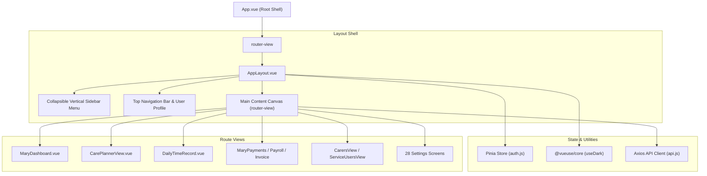

# Mary Care Management System — Frontend Technical Documentation

**Document File:** `docs/07-frontend-technical-guide.md`  
**Frontend Stack:** Vue 3.4 (`Composition API`, `<script setup>`), Element Plus 2.6, Vite 5.1, Pinia 2.1  
**Target Audience:** Frontend Engineers, UI/UX Developers, Full-Stack Engineers  
**Version:** 1.0.0 Production  
**Date:** October 2026  

---

## 1. Frontend Architecture & Design Philosophy

The **Mary Care Management System** frontend (`mary-view-element`) is engineered as a modern, reactive Single Page Application (SPA). The application enforces strict modularity, high performance, and accessibility across both desktop coordinator stations and mobile field devices.



---

## 2. Directory Structure

```text
mary-view-element/
├── public/                 # Static assets, logos, favicon
├── src/
│   ├── assets/             # Global SCSS/CSS stylesheets
│   ├── components/         # Complex domain components
│   │   └── MaryCarePlanner.vue   # Integrated Syncfusion Rota Scheduling Canvas
│   ├── layout/
│   │   └── AppLayout.vue   # Main layout container (Sidebar, Header, Main, Theme Switch)
│   ├── router/
│   │   └── index.js        # Vue Router configuration, route table & RBAC navigation guards
│   ├── service/            # HTTP communication layer
│   │   ├── api.js          # Central Axios instance with Bearer token & 401 interceptors
│   │   ├── AuthService.js  # Authentication endpoints wrapper
│   │   ├── FinanceService.js # Payments, payroll, and invoice API calls
│   │   └── scheduler.js    # DTR and scheduling data services
│   ├── store/
│   │   └── auth.js         # Pinia auth store with RBAC getters & session persistence
│   ├── views/              # Page view components
│   │   ├── management/     # Entity management (CarersView.vue, ServiceUsersView.vue)
│   │   ├── settings/       # 28 Reference catalog settings views
│   │   ├── AccessDenied.vue # 403 Forbidden Access Denied page
│   │   ├── Account.vue     # User profile and password management
│   │   ├── AuditLogsView.vue # UK GDPR Article 9 audit log viewer
│   │   ├── CarePlannerView.vue # Visual care scheduling page
│   │   ├── DailyTimeRecord.vue # Comprehensive timesheet reconciliation view
│   │   ├── Login.vue       # Authentication login page
│   │   ├── MaryAttendance.vue # Field carer attendance clocking portal
│   │   ├── MaryDashboard.vue # Executive dashboard analytics
│   │   ├── MaryInvoice.vue # Client and commissioner invoicing
│   │   ├── MaryPayments.vue # Transaction pay generator
│   │   ├── MaryPayroll.vue # Carer payroll management
│   │   ├── PrivacyPolicy.vue # UK GDPR Article 13/14 statutory notice
│   │   ├── ResetPassword.vue # Token-based password recovery page
│   │   └── UserManual.vue  # Interactive system user guide
│   ├── App.vue             # Root component with Element Plus configuration
│   └── main.js             # Application initialization, Pinia & Element Plus imports
├── Dockerfile              # Production multi-stage Docker build
├── nginx.conf              # Production Nginx reverse proxy configuration
├── package.json            # Dependencies and NPM scripts
└── vite.config.js          # Vite configuration & build options
```

---

## 3. State Management (`src/store/auth.js`)

Centralized session and role state is managed using **Pinia**:

```javascript
export const useAuthStore = defineStore('auth', {
  state: () => ({
    token: localStorage.getItem('token') || sessionStorage.getItem('token') || null,
    isAuthenticated: Boolean(localStorage.getItem('token') || sessionStorage.getItem('token')),
    user: JSON.parse(localStorage.getItem('user') || sessionStorage.getItem('user') || 'null'),
    sessionValidated: false
  }),

  getters: {
    isLoggedIn: (state) => Boolean(state.token),
    currentUser: (state) => state.user,
    userRole: (state) => Number(state.user?.role || 3),
    isAdmin: (state) => Boolean(Number(state.user?.role) === 1 || Number(state.user?.is_admin) === 1),
    isStaff: (state) => Boolean(Number(state.user?.role) === 2),
    isCarer: (state) => Boolean(Number(state.user?.role) === 3 && Number(state.user?.is_admin) !== 1),
    hasStaffAccess: (state) => {
      const role = Number(state.user?.role)
      const isAdminFlag = Number(state.user?.is_admin) === 1
      return isAdminFlag || role === 1 || role === 2
    },
    hasFinanceAccess: (state) => {
      const role = Number(state.user?.role)
      const isAdminFlag = Number(state.user?.is_admin) === 1
      if (isAdminFlag || role === 1) return true
      return role === 2 && isAdminFlag
    },
    hasCarerAccess: (state) => Boolean(state.user)
  },

  actions: {
    setAuthenticationToken(token, remember = true) { ... },
    setUser(user, remember = true) { ... },
    async validateSession() { ... },
    logout() { ... },
    checkAccess(roles, permissions) { ... }
  }
})
```

---

## 4. HTTP Communication Layer (`src/service/api.js`)

All backend communication utilizes a centralized Axios instance:
1. **Request Interceptor:** Automatically extracts active token from storage and injects `Authorization: Bearer <token>` into HTTP headers.
2. **Response Interceptor:** Intercepts `401 Unauthorized` responses, clears invalid credentials, and triggers a clean redirect to `/login?reason=expired`.
3. **Base URL:** Relative prefix `/api/v1` routes transparently to the backend via Vite dev server proxy or Nginx in production.

---

## 5. Comprehensive Page Inventory

| Route Path | View Component | Access Role | Description |
| :--- | :--- | :---: | :--- |
| `/login` | `Login.vue` | Public | Username/password authentication with "Remember Me". |
| `/reset-password` | `ResetPassword.vue` | Public | Password recovery with token validation. |
| `/privacy-policy` | `PrivacyPolicy.vue` | Public | UK GDPR / DPA 2018 statutory privacy notice. |
| `/access-denied` | `AccessDenied.vue` | Public | Polite 403 Forbidden screen with portal routing. |
| `/` | `MaryDashboard.vue` | Admin (`1`) | High-level metrics, visit trends, compliance rates. |
| `/planner` | `CarePlannerView.vue`| Staff (`1, 2`) | Visual scheduling calendar for carers and clients. |
| `/attendance` | `MaryAttendance.vue` | All (`1, 2, 3`) | Field carer visit logs, clock-in/out, care notes. |
| `/dtr` | `DailyTimeRecord.vue`| Staff (`1, 2`) | Timesheet variance analysis and reconciliations. |
| `/payments` | `MaryPayments.vue` | Finance (`has_finance`)| Reconciles unbatched shift transactions. |
| `/payroll` | `MaryPayroll.vue` | Finance (`has_finance`)| Finalized carer payroll batches. |
| `/invoice` | `MaryInvoice.vue` | Finance (`has_finance`)| Client and commissioner invoice batches. |
| `/management/carers` | `CarersView.vue` | Staff (`1, 2`) | Staff directory, DBS tracking, training compliance. |
| `/management/service-users`| `ServiceUsersView.vue`| Staff (`1, 2`) | Client records, clinical needs, SAR export. |
| `/audit-logs` | `AuditLogsView.vue` | Admin (`1`) | UK GDPR Article 9 special category access logs. |
| `/account` | `Account.vue` | All (`1, 2, 3`) | Personal user profile and password change form. |
| `/user-manual` | `UserManual.vue` | Staff (`1, 2`) | Comprehensive in-app user guide and tutorials. |
| `/settings/rates` | `SettingsRates.vue` | Staff (`1, 2`) | Service User Rates master pricing matrix. |
| `/settings/branches` | `SettingsBranches.vue` | Staff View / Admin Edit | Agency branches master catalog. |
| `/settings/*` (26 screens)| `Settings*.vue` | Staff (`1, 2`) | Care types, conditions, NHS, GP, genders, etc. |

---

## 6. Key Reusable Components

### 6.1 `GenericSettingsView.vue`
A generic CRUD wrapper powering 20+ reference catalog screens:
- Provides searchable table view, sorting, status badges (`Active`/`Inactive`), and responsive pagination.
- Includes integrated Create/Edit modal dialog with form validation.
- Dynamically respects role permissions (for example, hiding Add/Edit/Delete actions on Branches for non-admins).

### 6.2 `MaryCarePlanner.vue`
Complex visual calendar scheduling component:
- Integrates Syncfusion Vue Schedule with custom event templates.
- Supports drag-and-drop shift reallocation.
- Real-time client-to-carer competency matching.

---

## 7. Build & Optimization Pipeline

The application compiles via **Vite 5.1** into highly optimized, production-ready bundles:
```bash
npm run build
```
- **Module Transformation:** Transforms over 2,200 Vue and JS modules.
- **Chunk Splitting:** Heavy vendor chunks (Element Plus, Syncfusion, Chart.js) are code-split into discrete lazy-loaded chunks.
- **Asset Hashing:** Output filenames (`[name]-[hash].js`, `[name]-[hash].css`) enable aggressive browser caching.
- **Production Asset Output:** Emits to `dist/` ready for Nginx static serving.
