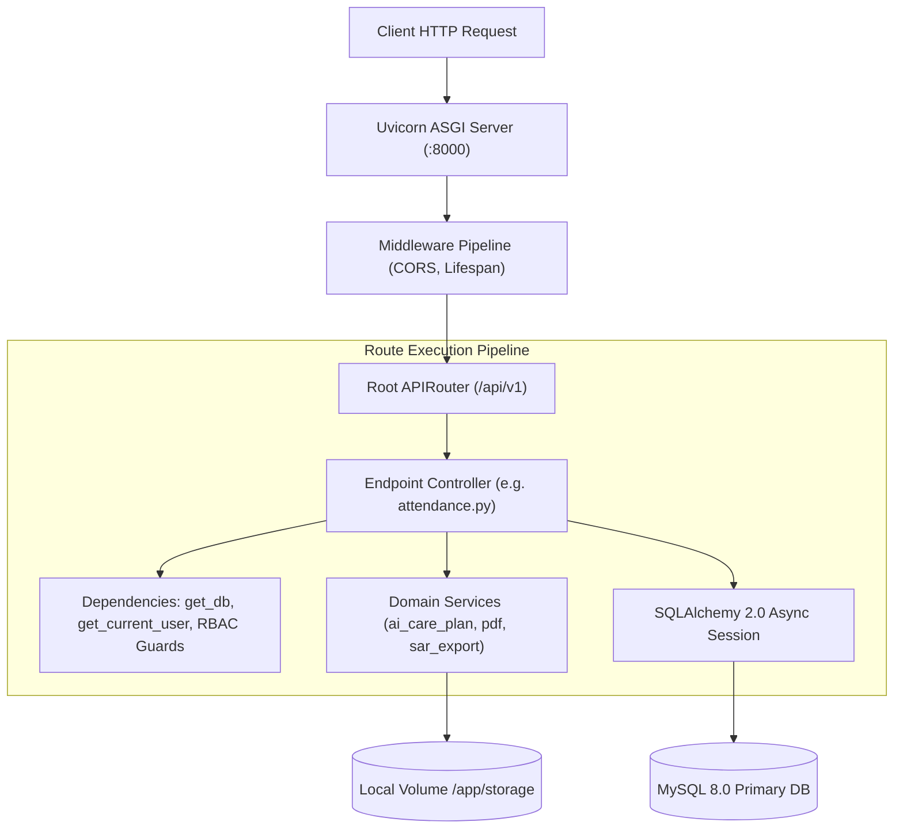

# Mary Care Management System — Backend Technical Documentation

**Document File:** `docs/08-backend-technical-guide.md`  
**Backend Runtime:** Python 3.12 (CPython)  
**API Framework:** FastAPI 0.110.x, Starlette, Pydantic v2  
**ORM:** SQLAlchemy 2.0.x (Asynchronous Mode) + `aiomysql`  
**Target Audience:** Backend Engineers, API Developers, Systems Architects  
**Version:** 1.0.0 Production  
**Date:** October 2026  

---

## 1. Backend Architecture & Philosophy

The **Mary Care Management System** backend (`mary-api-fastapi`) is built on asynchronous Python, maximizing I/O concurrency while maintaining strict type safety and schema validation. The service operates statelessly, enabling horizontal scale across multi-worker deployments.



---

## 2. Directory Structure & Code Organization

```text
mary-api-fastapi/
├── app/
│   ├── api/
│   │   └── v1/
│   │       ├── endpoints/      # Domain controllers
│   │       │   ├── attendance.py   # ECM clock-in/out & care notes
│   │       │   ├── audit.py        # UK GDPR Article 9 access logs
│   │       │   ├── auth.py         # Login, tokens, password recovery
│   │       │   ├── dashboard.py    # Executive metrics & summaries
│   │       │   ├── finance.py      # Transactions, payroll, invoices
│   │       │   ├── master_data.py  # 28 reference catalogs & rates matrix
│   │       │   ├── service_users.py# Client records & SAR export
│   │       │   ├── shifts.py       # Rota shifts & recurrence
│   │       │   └── users.py        # Carer staff directory
│   │       └── api.py          # Central router aggregation & router-level guards
│   ├── core/
│   │   ├── config.py           # Pydantic BaseSettings environment configuration
│   │   └── security.py         # JWT tokens, bcrypt hashing, RBAC dependencies
│   ├── db/
│   │   └── session.py          # Async engine, AsyncSessionLocal factory, get_db
│   ├── models/                 # SQLAlchemy 2.0 Declarative ORM models
│   ├── schemas/                # Pydantic v2 validation models
│   └── services/               # Reusable domain business services
│       ├── ai_care_plan.py     # NLP template Care Note generator
│       ├── audit.py            # Automated audit logging helper
│       ├── excel_import.py     # Spreadsheet timesheet parser
│       ├── gps.py              # Haversine distance geofencing
│       ├── pdf_generator.py    # WeasyPrint NHS-styled PDF generator
│       ├── recurrence.py       # Rota pattern series expansion
│       └── sar_export.py       # Article 15 multi-tab Excel compiler
├── storage/                    # Persistent storage on host
│   ├── care_notes/             # Generated PDF visit notes
│   ├── exports/                # Generated SAR dossiers
│   └── logs/                   # Local application and mail logs
├── Dockerfile                  # Production container definition
├── main.py                     # Application factory and lifespan event loop
├── requirements.txt            # Python package dependencies
└── test_rbac_parity.py         # Automated RBAC verification test suite
```

---

## 3. Dependency Injection Pattern

FastAPI's dependency injection (`Depends`) is leveraged for database session lifecycles, authentication, and role authorization:

### 3.1 Database Session Injection (`get_db`)
```python
async def get_db():
    async with AsyncSessionLocal() as session:
        try:
            yield session
        finally:
            await session.close()
```
Guarantees every request receives a dedicated, non-blocking asynchronous session that is safely closed upon completion or exception.

### 3.2 Security & Role Guards
Endpoints inject hierarchical security dependencies defined in [`app/core/security.py`](file:///c:/Projects/Mary/mary-api-fastapi/app/core/security.py):
- `current_user: User = Depends(get_current_active_user)`: Guarantees authenticated, unsuspended user.
- `current_user: User = Depends(get_current_staff_user)`: Enforces Staff or Admin access (`Role 1, 2`).
- `current_user: User = Depends(get_current_finance_user)`: Enforces Financial access (`Role 1` or `Role 2 with is_admin: 1`).
- `current_user: User = Depends(get_current_admin_user)`: Enforces Super Administrator access (`Role 1` or `is_admin: 1`).

---

## 4. Asynchronous Database Engine (`app/db/session.py`)

Database connectivity utilizes an asynchronous engine pool:
```python
engine = create_async_engine(
    settings.DATABASE_URL,
    echo=False,
    future=True,
    pool_size=20,
    max_overflow=10,
    pool_recycle=3600,
    pool_pre_ping=True
)
AsyncSessionLocal = async_sessionmaker(
    bind=engine,
    class_=AsyncSession,
    expire_on_commit=False,
    autoflush=False
)
```
- **`pool_pre_ping=True`:** Validates connection health before issuing queries, eliminating "MySQL server has gone away" errors.
- **`pool_recycle=3600`:** Recycles idle connections every hour, preventing firewall timeouts.

---

## 5. Domain Business Services

### 5.1 WeasyPrint Clinical Care Note PDF Generator ([`app/services/pdf_generator.py`](file:///c:/Projects/Mary/mary-api-fastapi/app/services/pdf_generator.py))
Converts structured visit outcome data into an official NHS-styled PDF document:
- Renders an inline HTML5/CSS3 template with NHS Blue headers, two-column attribute matrices, medication checklists, and carer signatures.
- Uses WeasyPrint with Cairo graphics rasterization to produce crisp vector A4 documents stored under `storage/care_notes/`.

### 5.2 UK GDPR Article 15 SAR Dossier Compiler ([`app/services/sar_export.py`](file:///c:/Projects/Mary/mary-api-fastapi/app/services/sar_export.py))
Compiles complete data subject dossiers:
- Queries client records, Next of Kin, scheduled shifts, attendance logs, clinical care notes, and Article 9 access logs.
- Uses OpenPyXL to format a multi-tab workbook with styled header rows, column auto-sizing, and frozen panes.

### 5.3 GPS Haversine Distance Geofencing ([`app/services/gps.py`](file:///c:/Projects/Mary/mary-api-fastapi/app/services/gps.py))
Computes great-circle distance between carer mobile device coordinates and client home address:
$$\text{distance} = 2 R \arcsin\left(\sqrt{\sin^2\left(\frac{\Delta \phi}{2}\right) + \cos(\phi_1)\cos(\phi_2)\sin^2\left(\frac{\Delta \lambda}{2}\right)}\right)$$
Identifies visits clocked outside the authorized 500-meter radius.

---

## 6. Error Handling & Exception Management

FastAPI automatically translates schema validation errors into structured `422 Unprocessable Entity` responses. Domain errors throw explicit `HTTPException` instances:

```python
if user.carer_status_id == 5:
    raise HTTPException(
        status_code=status.HTTP_403_FORBIDDEN,
        detail="Account is currently suspended. Please contact your coordinator."
    )
```

Global error handlers ensure unhandled exceptions log stack traces securely while returning sanitized error payloads to clients:
```json
{
  "detail": "An internal error occurred while generating the document. Please contact support."
}
```

---

## 7. Middleware & Application Lifecycle (`main.py`)

- **Lifespan Manager:** Executes asynchronous startup and shutdown routines, auto-verifying database table metadata on launch.
- **CORS Middleware:** Manages cross-origin headers, credentials, and allowed HTTP methods.
- **Health Check Endpoint:** `GET /healthz` returns service health without triggering database locks, enabling external load balancer monitoring.
