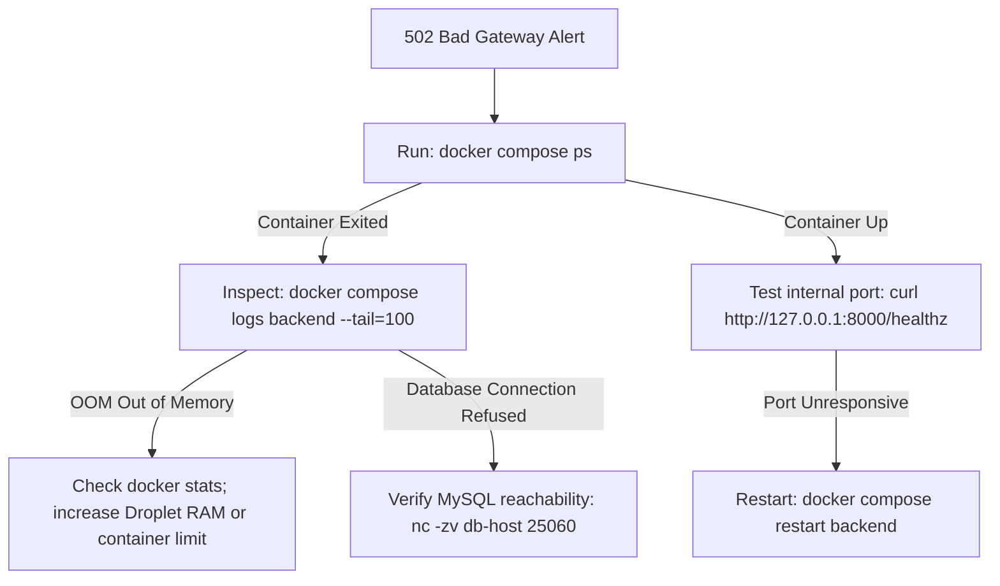
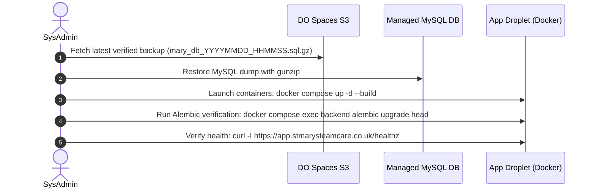

# Mary Care Management System — Operations Runbook (Docker & Docker Compose)

**Document File:** `docs/11-operations-runbook.md`  
**Target Audience:** DevOps Engineers, System Administrators, L2/L3 Support Personnel  
**Deployment Infrastructure:** Docker Compose on Ubuntu 24.04 LTS (DigitalOcean)  
**System Criticality:** High (24/7 Domiciliary Health & Social Care Services)  
**Version:** 2.0.0 Containerized Operations  
**Date:** October 2026  

---

## 1. System Overview & Service Inventory

The Mary Care Management System production stack runs on DigitalOcean with Docker Compose managing isolated application containers behind host Nginx:

| Service Name | Container / Process | Technology | Internal Port | Host / Forwarded Port | Log Location |
| :--- | :--- | :--- | :---: | :---: | :--- |
| **`host-nginx`** | Host Process | Nginx Reverse Proxy & SSL | `:80`, `:443` | Public `:80`, `:443` | `/var/log/nginx/access.log`, `error.log` |
| **`mary_frontend`** | Container | Nginx + Vue 3 SPA | `:80` | `127.0.0.1:8080` | `docker compose logs frontend` |
| **`mary_backend`** | Container | Python 3.12 / FastAPI (WeasyPrint) | `:8000` | `127.0.0.1:8000` | `docker compose logs backend`, `/var/mary/storage/logs/` |
| **`mary_redis`** | Container | Redis 7 Alpine | `:6379` | Internal bridge network | `docker compose logs redis` |
| **`mysql`** | Managed Database | DigitalOcean Managed MySQL | `:25060` (TLS) | DigitalOcean VPC | DigitalOcean Dashboard & Insights |

Working Directory for Docker commands: `/var/mary`

---

## 2. Daily Operational Checklist

Every morning at **07:00 UTC** (prior to the peak 07:30 morning visit window), Operations personnel must verify system status:

1. **Uptime & API Health Check:**
   ```bash
   curl -I https://app.stmarysteamcare.co.uk/healthz
   # Expect: HTTP/1.1 200 OK
   ```
2. **Container Status & Health Verification:**
   ```bash
   cd /var/mary && docker compose -f docker-compose.prod.yml ps
   # All containers (mary_backend, mary_frontend, mary_redis) must show 'Up' / 'healthy'.
   ```
3. **Review Backend Error Logs for Recurring Exceptions:**
   ```bash
   docker compose -f docker-compose.prod.yml logs --tail=50 backend | grep -i error
   ```
4. **Verify Nightly Database Backup Success:**
   ```bash
   s3cmd ls s3://mary-care-backups/database/ | tail -n 3
   # Verify a backup file matching today's date exists and has non-zero size (> 5 MB).
   ```
5. **Check Droplet Disk & Memory Utilization:**
   ```bash
   df -h /
   # Ensure root partition usage is below 80%.
   free -m
   # Ensure available RAM is greater than 800 MB.
   docker stats --no-stream
   ```

---

## 3. Standard Service Operations & Restart Procedures

All commands are executed from `/var/mary`:

### 3.1 Restarting Backend Service
Restart only the backend container without disrupting the frontend:
```bash
cd /var/mary
docker compose -f docker-compose.prod.yml restart backend
```

### 3.2 Full Stack Restart
```bash
cd /var/mary
docker compose -f docker-compose.prod.yml restart
docker compose -f docker-compose.prod.yml ps
```

### 3.3 Rebuilding Containers after Code Pull
```bash
cd /var/mary
git pull origin main  # or git pull in respective submodules
docker compose -f docker-compose.prod.yml up -d --build
```

### 3.4 Inspecting Live Application Logs
```bash
# Follow live backend logs
docker compose -f docker-compose.prod.yml logs -f backend

# Follow live frontend access logs
docker compose -f docker-compose.prod.yml logs -f frontend

# Follow all containers simultaneously
docker compose -f docker-compose.prod.yml logs -f --tail=100
```

### 3.5 Interactive Debug Shell inside Backend Container
```bash
docker compose -f docker-compose.prod.yml exec backend bash
```

### 3.6 Reloading Host Nginx Configuration
```bash
sudo nginx -t && sudo systemctl reload nginx
```

---

## 4. Incident Response Playbooks

### Incident Playbook A: HTTP 502 Bad Gateway
**Symptom:** Browser displays Nginx 502 Bad Gateway error.  
**Root Cause:** The `mary_backend` container is stopped, restarting, or unresponsive.



**Remediation Steps:**
1. Check container status:
   ```bash
   cd /var/mary && docker compose -f docker-compose.prod.yml ps
   ```
2. If `mary_backend` is restarting or exited, inspect crash traceback:
   ```bash
   docker compose -f docker-compose.prod.yml logs --tail=100 backend
   ```
3. Restart backend container:
   ```bash
   docker compose -f docker-compose.prod.yml restart backend
   ```
4. Confirm health:
   ```bash
   curl -I http://127.0.0.1:8000/healthz
   ```

---

### Incident Playbook B: Database Connection Timeout / Deadlock
**Symptom:** API requests hang and return HTTP 500; logs show `aiomysql.OperationalError: (2013, 'Lost connection to MySQL server')`.

**Remediation Steps:**
1. Check network connectivity to DigitalOcean Managed MySQL:
   ```bash
   nc -zv db-mysql-lon1-do-user-1234.b.db.ondigitalocean.com 25060
   ```
2. Verify active connection pool in DigitalOcean Dashboard &rarr; Databases &rarr; Metrics.
3. Test database ping from inside backend container:
   ```bash
   docker compose -f docker-compose.prod.yml exec backend python -c "
   import asyncio
   from app.core.database import check_db_health
   asyncio.run(check_db_health())
   "
   ```
4. If threads are deadlocked, restart backend container:
   ```bash
   docker compose -f docker-compose.prod.yml restart backend
   ```

---

### Incident Playbook C: Droplet Disk Full (Docker Pruning & Log Rotation)
**Symptom:** WeasyPrint fails with `IOError: No space left on device`; Docker builds fail with `no space left on device`.

**Remediation Steps:**
1. Check disk utilization:
   ```bash
   df -h /
   ```
2. Prune dangling Docker images, build caches, and unused containers:
   ```bash
   docker system prune -af --volumes=false
   docker builder prune -af
   ```
3. Clean temporary SAR export files older than 30 days:
   ```bash
   find /var/mary/storage/exports/ -type f -mtime +30 -delete
   ```
4. Truncate host system journals:
   ```bash
   sudo journalctl --vacuum-time=7d
   ```

---

## 5. Disaster Recovery & Restoration Procedure



### Recovery Steps:
1. Retrieve backup archive from DO Spaces:
   ```bash
   s3cmd get s3://mary-care-backups/database/mary_db_20261013_020000.sql.gz /tmp/
   ```
2. Restore database into DigitalOcean Managed MySQL:
   ```bash
   gunzip -c /tmp/mary_db_20261013_020000.sql.gz | mysql -u doadmin -p'password' \
       -h db-mysql-lon1.ondigitalocean.com -P 25060 \
       --ssl-ca=/var/mary/certs/ca-certificate.crt mary_api_db_new
   ```
3. Re-launch Docker Compose containers:
   ```bash
   cd /var/mary
   docker compose -f docker-compose.prod.yml up -d --build
   docker compose -f docker-compose.prod.yml exec backend alembic upgrade head
   ```
4. Target Recovery Time Objective (RTO): **< 30 minutes**.  
   Target Recovery Point Objective (RPO): **< 24 hours** (or point-in-time via DO Managed MySQL binary logs).

---

## 6. Support Escalation Matrix

| Severity Level | Definition | Response SLA | Primary Contact | Escalation Contact |
| :--- | :--- | :---: | :--- | :--- |
| **Sev-1 (Critical)** | Entire platform down; carers unable to clock in; clients at risk. | **< 15 mins** | On-Call DevOps Engineer | Technical Director |
| **Sev-2 (Major)** | Core module down (e.g., Invoicing or Rota Planner broken); workaround unavailable. | **< 2 hours** | Lead Backend Engineer | Lead Architect |
| **Sev-3 (Minor)** | Non-blocking bug; isolated client/carer UI display glitch. | **< 24 hours** | Frontend / Support Dev | Product Owner |
| **Sev-4 (Cosmetic)** | Text styling, minor typo, or UI alignment issue. | Next Sprint | Support Team | Product Backlog |
