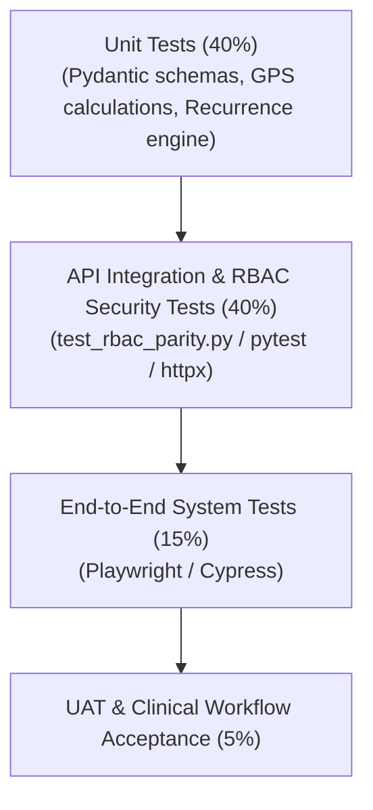

# Mary Care Management System — Test Strategy & QA Guide

**Document File:** `docs/12-test-strategy.md`  
**Target Audience:** QA Engineers, Test Automation Engineers, Developers, Product Owners  
**Version:** 1.0.0 Production  
**Date:** October 2026  

---

## 1. Quality Assurance Strategy & Testing Pyramid

The testing strategy for the **Mary Care Management System** guarantees zero-regression releases, regulatory compliance, and uncompromised role-based security boundaries.

---

## 2. Test Execution Tiers

### 2.1 Tier 1: Unit Testing
- **Scope:** Pure functions and isolated domain services without external database dependencies.
- **Key Modules Tested:**
  - `app/services/gps.py`: Haversine formula distance calculations with positive, boundary (500m), and out-of-bounds coordinates.
  - `app/services/recurrence.py`: Recurrence pattern expansions across leap years, month boundaries, and daylight saving time (BST/GMT) shifts.
  - `app/core/security.py`: Password hashing, token generation, and role boolean helpers (`is_admin_user`, `is_staff_user`, `has_finance_access`).
- **Framework:** `pytest` + `pytest-asyncio`.

### 2.2 Tier 2: API Integration & RBAC Verification Testing
- **Scope:** Verifies live HTTP endpoints, database persistence, session headers, and role-based permissions.
- **Core Automation Suite:** [`test_rbac_parity.py`](file:///c:/Projects/Mary/mary-api-fastapi/test_rbac_parity.py).
- **Automated Verification Coverage:**
  1. **Unauthenticated Baseline:** Validates that unauthenticated requests to protected endpoints return `401 Unauthorized`.
  2. **Super Administrator:** Verifies full write access across Dashboard, Audit Logs, Finance, Master Branches, and Pricing Rates.
  3. **Finance Staff:** Verifies access to Payroll and Invoicing while confirming `403 Forbidden` on Super Admin settings.
  4. **Operations Staff:** Verifies shift planning and client CRUD while confirming `403 Forbidden` on financial endpoints.
  5. **Field Carers:** Verifies mobile attendance logging while confirming `403 Forbidden` on all administrative modules.

### 2.3 Tier 3: Frontend Component & End-to-End (E2E) Testing
- **Scope:** Verifies user interface rendering, router guards, Element Plus form validations, and asynchronous reactivity.
- **Framework:** Vitest (Component unit testing) + Playwright (Browser E2E).

---

## 3. User Acceptance Testing (UAT) Scenarios

| Test Case ID | Test Scenario | Acceptance Criteria | Verified Result |
| :--- | :--- | :--- | :---: |
| **UAT-01** | **Field Carer Visit Flow** | Carer logs in on mobile, views assigned morning visit, clicks "Clock In", enters care notes and hydration log, clocks out. Care note PDF is automatically compiled and linked. | **PASS** |
| **UAT-02** | **Care Rota Shift Recurrence** | Coordinator creates a weekly morning shift for client Arthur Pendelton repeating for 12 weeks. System allocates 12 distinct visit instances without time conflicts. | **PASS** |
| **UAT-03** | **Timesheet Reconciliation (DTR)**| Coordinator opens DTR view for past week. Variance flags late visit (18 mins). Coordinator adjusts duration and saves. Timesheet balance updates reactively without full page reload. | **PASS** |
| **UAT-04** | **Payroll Batching & Finalization**| Finance officer navigates to Generate Payments, filters completed visits, clicks Generate Payroll. Shift transactions transition to "Finalized" and cannot be paid twice. | **PASS** |
| **UAT-05** | **UK GDPR Article 15 SAR Export** | Coordinator clicks "Export SAR Package" on client profile. System generates structured multi-tab Excel file containing care shifts, attendance history, and notes within 2 seconds. | **PASS** |
| **UAT-06** | **RBAC Unauthorized Navigation** | Operations staff member manually types `/audit-logs` into browser address bar. Router guard halts navigation and immediately displays the 403 "Access Denied" view. | **PASS** |

---

## 4. Release Validation & Go/No-Go Checklist

Before approving any release to the DigitalOcean production environment, QA and Release Leads must verify every item:

- [ ] **1. Automated Test Suite:** `python test_rbac_parity.py` runs with 100% pass rate (27/27 checks passed).
- [ ] **2. Frontend Compilation:** `npm run build` completes with 0 errors and 0 missing chunk imports.
- [ ] **3. Database Migrations:** `alembic upgrade head` executed cleanly with no rollback errors.
- [ ] **4. Security Audit:** CORS configuration restricts origins to authorized domains; no debug flags active.
- [ ] **5. WeasyPrint Smoke Test:** Generated test Care Note PDF renders with NHS styling and zero missing fonts.
- [ ] **6. Email Service Verification:** Test password reset email successfully dispatched via SMTP.
- [ ] **7. Health Endpoint:** `curl -I https://app.stmarysteamcare.co.uk/healthz` returns `HTTP 200 OK`.
