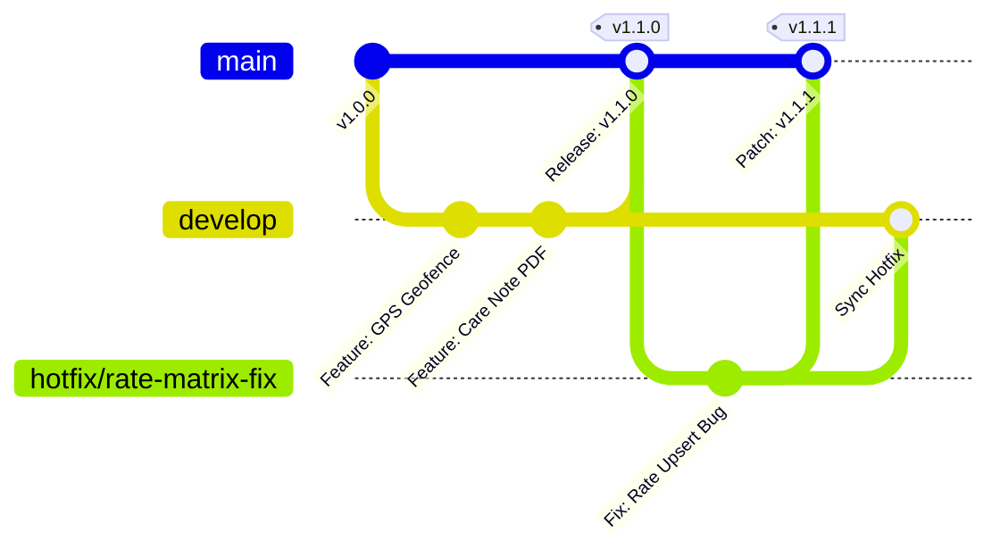
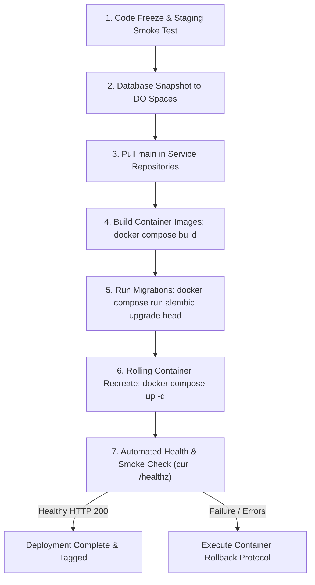

# Mary Care Management System — Release & Change Management Guide (Docker & Containerized Workflow)

**Document File:** `docs/15-release-management.md`  
**Target Audience:** Release Managers, Product Owners, Lead Engineers, DevOps  
**Deployment Model:** Containerized Continuous Delivery via **Docker & Docker Compose**  
**Version:** 2.0.0 Production  
**Date:** October 2026  

---

## 1. Branching Strategy (GitFlow Adapted)

The engineering workflow utilizes an adapted GitFlow branching model to guarantee that `main` is always deployable to production:



### 1.1 Branch Roles
- **`main`:** Production branch. Contains only tested, audited, and tagged release commits. Direct commits are strictly prohibited.
- **`develop`:** Integration branch. All new feature branches merge here via reviewed Pull Requests (PRs).
- **`feature/<feature-name>`:** Short-lived feature branches branched from `develop`.
- **`hotfix/<issue-name>`:** Emergency patch branches branched directly from `main` to address critical production defects.

---

## 2. Versioning Strategy (Semantic Versioning 2.0.0)

Version numbers adhere to `MAJOR.MINOR.PATCH`:
- **MAJOR (e.g., 2.0.0):** Incompatible architectural overhauls, database schema breaking migrations, or major regulatory restructurings.
- **MINOR (e.g., 1.1.0):** Backwards-compatible new features (such as adding new CQC report formats, new master data settings, or mobile portal enhancements).
- **PATCH (e.g., 1.0.1):** Backwards-compatible bug fixes, UI styling patches, or performance index updates.

---

## 3. Production Deployment Workflow (Docker Compose)

Production deployments are scheduled during low-traffic operational windows (**Tuesdays & Thursdays at 22:00 UTC**), avoiding peak morning visit hours.



### 3.1 Execution Commands on Production Server
```bash
cd /var/mary

# Step 1: Create pre-deployment database backup
/usr/local/bin/mary-backup.sh

# Step 2: Pull latest code from main
cd /var/mary/mary-api-fastapi && git pull origin main
cd /var/mary/mary-view-element && git pull origin main
cd /var/mary

# Step 3: Build updated container images
docker compose -f docker-compose.prod.yml build

# Step 4: Apply database migrations in temporary backend container
docker compose -f docker-compose.prod.yml run --rm backend alembic upgrade head

# Step 5: Rolling restart with new images
docker compose -f docker-compose.prod.yml up -d --no-deps backend frontend

# Step 6: Verify health check
curl -I https://app.stmarysteamcare.co.uk/healthz
```

---

## 4. Rollback Strategy & Emergency Reversion

If a deployment fails health checks or introduces critical runtime regressions:

### Step 1: Revert Code to Previous Git Tag
```bash
cd /var/mary/mary-api-fastapi
git checkout tags/v1.0.0  # Check out previous stable tag

cd /var/mary/mary-view-element
git checkout tags/v1.0.0

cd /var/mary
```

### Step 2: Roll Back Database Schema (if required)
```bash
docker compose -f docker-compose.prod.yml run --rm backend alembic downgrade -1
```

### Step 3: Rebuild & Restart Containers with Previous Stable Code
```bash
docker compose -f docker-compose.prod.yml up -d --build
```

### Step 4: Verify Restored Health
```bash
curl -I https://app.stmarysteamcare.co.uk/healthz
```

---

## 5. Hotfix Protocol

When a Sev-1 or Sev-2 incident occurs in production requiring an emergency patch:

1. **Branch Hotfix:** Create `hotfix/<ticket-id>` from `main`.
2. **Implement & Test:** Apply targeted minimal patch; verify locally via `docker compose up -d --build` and `python test_rbac_parity.py`.
3. **Approval:** Obtain sign-off from Lead Architect and Product Owner.
4. **Deploy:** Deploy directly to production Droplet via the containerized release procedure.
5. **Backport:** Merge the hotfix back into `develop` immediately to prevent regression.

---

## 6. Pre-Release & Post-Release Checklists

### 6.1 Pre-Release Checklist
- [ ] All automated tests pass (`test_rbac_parity.py`, unit test suites).
- [ ] Database migration tested forwards and backwards on staging.
- [ ] No high or critical severity npm / pip vulnerabilities (`npm audit`, `pip audit`).
- [ ] Docker container build succeeds without cache warnings.
- [ ] Operational team notified of maintenance window.

### 6.2 Post-Release Checklist
- [ ] `/healthz` returns `HTTP 200 OK`.
- [ ] Login test succeeds with test Admin and Carer credentials.
- [ ] Care Planner renders visits without console errors.
- [ ] Shift check-in / check-out API returns valid response.
- [ ] Audit log entry verified in `m_audit_logs`.
- [ ] Release tagged in Git (`git tag -a v1.1.0 -m "Release v1.1.0"`).
