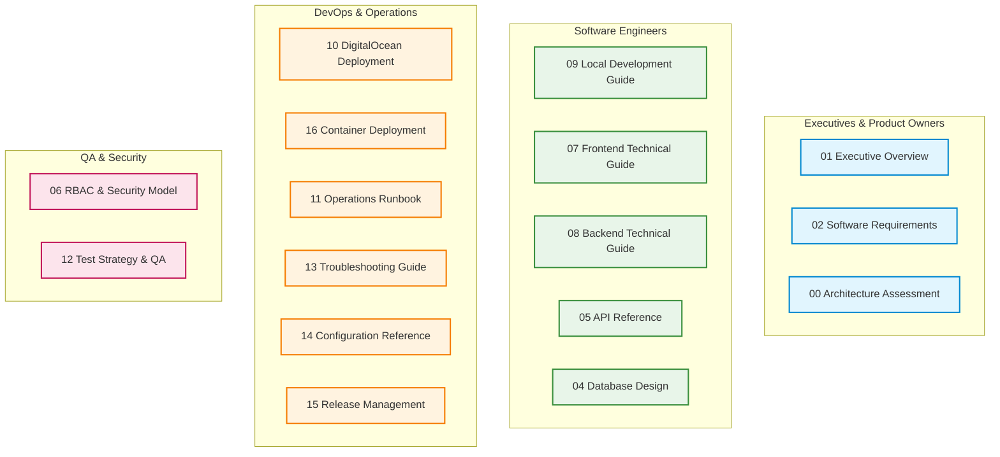

# Mary Care Management System — Documentation Suite

Welcome to the comprehensive technical and operational documentation suite for the **Mary Care Management System**. This suite covers end-to-end architecture, technical specifications, database design, API reference, security model, frontend/backend engineering guides, deployment procedures, operational runbooks, and QA strategies.

---

## 📚 Master Document Catalog

| # | Document | File | Target Audience | Primary Focus |
|---|---|---|---|---|
| **00** | [Architecture Assessment Report](file:///C:/Projects/Mary/mary-view-element/docs/00-architecture-assessment.md) | `00-architecture-assessment.md` | CTO, Architects, Project Leads | Health check, technical debt, risk evaluation, prioritized remediation roadmap |
| **01** | [Executive Overview](file:///C:/Projects/Mary/mary-view-element/docs/01-executive-overview.md) | `01-executive-overview.md` | Executives, Product Owners, Clients | Business purpose, value proposition, CQC & UK GDPR compliance, core capabilities |
| **02** | [Software Requirements Specification](file:///C:/Projects/Mary/mary-view-element/docs/02-software-requirements-specification.md) | `02-software-requirements-specification.md` | BAs, Product Owners, Developers | Functional requirements (FR-01 to FR-12), NFRs, business rules, validation criteria |
| **03** | [System Architecture Document](file:///C:/Projects/Mary/mary-view-element/docs/03-system-architecture.md) | `03-system-architecture.md` | Architects, Senior Devs, DevOps | C4 architecture, data flows, component interaction, ADRs, scalability patterns |
| **04** | [Database Design Document](file:///C:/Projects/Mary/mary-view-element/docs/04-database-design.md) | `04-database-design.md` | DBA, Backend Devs, Data Engineers | Mermaid ERD (72 tables), schema dictionary, indexes, soft-delete lifecycle, NHS retention |
| **05** | [API Reference Documentation](file:///C:/Projects/Mary/mary-view-element/docs/05-api-reference.md) | `05-api-reference.md` | Backend Devs, Frontend Devs, QA | OpenAPI endpoints, payload schemas, query parameters, auth headers, curl examples |
| **06** | [RBAC & Security Model](file:///C:/Projects/Mary/mary-view-element/docs/06-rbac-security-model.md) | `06-rbac-security-model.md` | Security Leads, Devs, Auditors | Role taxonomy, 18-module permissions matrix, route/endpoint guards, legacy parity review |
| **07** | [Frontend Technical Guide](file:///C:/Projects/Mary/mary-view-element/docs/07-frontend-technical-guide.md) | `07-frontend-technical-guide.md` | Frontend Devs, UI/UX Engineers | Vue 3 Composition API, Pinia stores, Element Plus, routing, complete page inventory |
| **08** | [Backend Technical Guide](file:///C:/Projects/Mary/mary-view-element/docs/08-backend-technical-guide.md) | `08-backend-technical-guide.md` | Backend Devs, Python Engineers | FastAPI async architecture, SQLAlchemy 2.0, dependency injection, domain services |
| **09** | [Installation & Local Dev Guide](file:///C:/Projects/Mary/mary-view-element/docs/09-local-development-guide.md) | `09-local-development-guide.md` | All Developers, Onboarding Staff | Docker & native workstation setup, seed credentials, WeasyPrint setup, local debugging |
| **10** | [DigitalOcean Deployment Guide](file:///C:/Projects/Mary/mary-view-element/docs/10-digitalocean-deployment-guide.md) | `10-digitalocean-deployment-guide.md` | DevOps, SysAdmins, Infrastructure | Production Droplet provisioning, Docker Compose multi-container stack, Nginx SSL, DO Spaces backup, zero-downtime rollout |
| **11** | [Operations Runbook](file:///C:/Projects/Mary/mary-view-element/docs/11-operations-runbook.md) | `11-operations-runbook.md` | Ops, SRE, Tier 2/3 Support | Morning 07:00 checklists, service restarts, disaster recovery, incident playbooks |
| **12** | [Test Strategy & QA Guide](file:///C:/Projects/Mary/mary-view-element/docs/12-test-strategy.md) | `12-test-strategy.md` | QA Engineers, Test Automation | Test pyramid, automated RBAC parity test suite, 6 core UAT scenarios, release checklist |
| **13** | [Troubleshooting Guide](file:///C:/Projects/Mary/mary-view-element/docs/13-troubleshooting-guide.md) | `13-troubleshooting-guide.md` | Support, On-call Engineers | Decision-tree flowchart, 502 Bad Gateway, token expiry, WeasyPrint errors, DB timeout |
| **14** | [Configuration Reference](file:///C:/Projects/Mary/mary-view-element/docs/14-configuration-reference.md) | `14-configuration-reference.md` | DevOps, Security, Developers | Environment variable dictionary, security flags, development vs staging vs prod matrix |
| **15** | [Release & Change Management](file:///C:/Projects/Mary/mary-view-element/docs/15-release-management.md) | `15-release-management.md` | Release Managers, Tech Leads | GitFlow branching, SemVer 2.0 rules, zero-downtime deploy steps, hotfix protocol |
| **16** | [Container Deployment Guide](file:///C:/Projects/Mary/mary-element/docs/16-container-deployment-guide.md) | `16-container-deployment-guide.md` | Developers, DevOps, SysAdmins | Step-by-step deploy of `mary_frontend`, `mary_backend`, `mary_redis`, and `mary_db` on Windows, and of the app containers plus Managed MySQL on DigitalOcean |

### Supplementary Parity & Compliance Reviews
* [RBAC Parity Review](file:///C:/Projects/Mary/mary-view-element/docs/rbac-parity-review.md) — Comprehensive comparative audit of Legacy Laravel ACL vs. FastAPI/Vue 3 RBAC.
* [Care Planner Parity Review](file:///C:/Projects/Mary/mary-view-element/docs/planner-parity-review.md) — Detailed feature parity audit for the interactive shift rota and visit planner.
* [UK GDPR Compliance Review](file:///C:/Projects/Mary/mary-view-element/docs/uk-gdpr-compliance-review.md) — Data protection impact, Article 9 audit trail, and Article 15 Subject Access Request compliance.
* [Service Users and Carers Parity](file:///C:/Projects/Mary/mary-view-element/docs/feature-parity-service-users-carers.md) — Legacy inventory, migrated workflows, GDPR grid decisions, remaining gaps, and the test checklist.

---

## 🗺️ Reading Paths by Stakeholder

---

## 🚀 Quick Start for Developers
1. Clone repository and review [09-local-development-guide.md](file:///C:/Projects/Mary/mary-view-element/docs/09-local-development-guide.md).
2. Configure `.env` files following [14-configuration-reference.md](file:///C:/Projects/Mary/mary-view-element/docs/14-configuration-reference.md).
3. Start backend (`python -m uvicorn app.main:app --reload --port 8000`) and frontend (`npm run dev`).
4. Validate API endpoints using [05-api-reference.md](file:///C:/Projects/Mary/mary-view-element/docs/05-api-reference.md).
