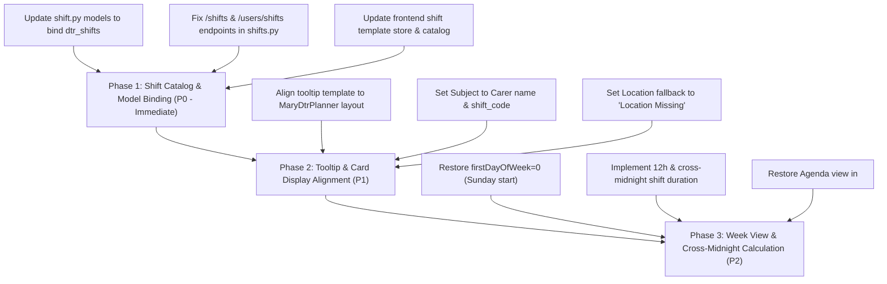

# Code Review & Parity Evaluation Report: MaryCarePlanner Implementation

**Document Reference:** `docs/planner-parity-review.md`  
**Target Codebase (New System):** `C:\Projects\Mary\mary-view-element\src\components\MaryCarePlanner.vue`  
**Legacy Reference Codebase (Source of Truth):** `C:\Apache24\htdocs\mary-view\src\views\pages\DailyTimeRecord.vue` & `MaryDtrPlanner.vue`  
**Companion Reference:** `C:\Apache24\htdocs\mary-view\src\views\pages\MaryCarePlanner.vue`  
**Related Backend Services:**  
- New System Backend: `C:\Projects\Mary\mary-api-fastapi\app\api\v1\endpoints\shifts.py` & `app\models\shift.py`  
- Legacy System Backend: `C:\Apache24\htdocs\mary-api\app\Http\Controllers\DtrShiftController.php` & `DtrUserShiftController.php`  
**Evaluation Date:** October 2026  
**Status:** Comprehensive Code Review, Parity Assessment & Screenshot Audit  

---

## 1. Executive Summary

### 1.1 Objective & Review Scope
This report provides a deep code review and visual parity analysis comparing the new **Care Planner** (`MaryCarePlanner.vue` in `mary-view-element` backed by FastAPI) against the authoritative legacy implementation (`DailyTimeRecord.vue` / `MaryDtrPlanner.vue` in `mary-view` backed by Laravel API).

Per strict project constraints:
- The legacy codebase is the immutable source of truth and must remain completely untouched.
- Both systems utilize the **Syncfusion EJ2 Vue Schedule** component as their scheduling engine.
- Because the scheduler engine remains identical, all scheduler behaviors, visual grouping, card formatting, hover popups, week-view layout, shift definitions, and interaction lifecycles must achieve full functional and behavioral parity.

---

## 2. Screenshot Validation Findings

A visual comparison between the live running legacy application and the newly implemented scheduler reveals distinct behavioral, visual, and data discrepancies.

| Visual Element | First Screenshot (Legacy System - Source of Truth) | Second Screenshot (New Target System) |
| :--- | :--- | :--- |
| **Active View / Navigation** | `< > 09-Oct-2026 ▾` `TODAY` `DAY` `WEEK` **`MONTH`** `TIMELINE DAY` `TIMELINE WEEK` `TIMELINE MONTH` `AGENDA` | Custom Dark Header Bar + `< > 09-Oct-2026 ▾` `TODAY` `DAY` `WEEK` **`MONTH`** `YEAR` `TIMELINE...` |
| **Week Column Order** | **Sunday**, Monday, Tuesday, Wednesday, Thursday, Friday, Saturday (`firstDayOfWeek="0"`) | **Monday**, Tuesday, Wednesday, Thursday, Friday, Saturday, Sunday (`firstDayOfWeek="1"`) |
| **Event Card Display** | `12:00 AM Adnan Ali;...` (Cyan `#00aeff` / Orange `#f9a825ff` color from `dtr_shifts`) | `8:00 AM Alan Hillman...` (Grey / Slate / Gold color from `m_shifts`) |
| **Tooltip Top Header** | **`Adnan Ali`** (Carer / Staff Name) | **`Alan Hillman`** (Service User / Client Name) |
| **Tooltip Shift Field** | **`Shift: 8AM - 8PM`** (from `dtr_shifts.shift_code`) | **`Shift: Live In shift`** (from `m_shifts.shift`) |
| **Tooltip Location Field** | **`Location: Location Missing`** | **`Location: Main Office`** |
| **Tooltip Start/End Times**| **`Start: 05-Oct-2026 08:00 AM`**<br>**`End: 05-Oct-2026 08:00 PM`** (12 Hours) | **`Start: 05-Oct-2026 08:00 AM`**<br>**`End: 05-Oct-2026 05:00 PM`** (9 Hours) |
| **Tooltip Footer Badges** | Clean minimal divider, no extra tags | Badges: `🔄 Recurring Series`, `⚡ Double-Up` |

```
+-------------------------------------------------------------------------------------------------------+
|                                    VISUAL COMPARISON BREAKDOWN                                        |
+-------------------------------------------------------------------------------------------------------+
| LEGACY TOOLTIP (Screenshot 1)                 | NEW TARGET TOOLTIP (Screenshot 2)                     |
| --------------------------------------------- | ----------------------------------------------------- |
|  Adnan Ali                                    |  Alan Hillman                                         |
|  ------------------------                     |                                                       |
|  Shift:    8AM - 8PM                          |  Carer:    Adnan Ali                                  |
|  Location: Location Missing                   |  Shift:    Live In shift                              |
|  - - - - - - - - - - - - -                    |  Location: Main Office                                |
|  Start: 05-Oct-2026 08:00 AM                  |  - - - - - - - - - - - - - - - -                      |
|  End:   05-Oct-2026 08:00 PM                  |  Start: 05-Oct-2026 08:00 AM                          |
|                                               |  End:   05-Oct-2026 05:00 PM                          |
|                                               |  [ 🔄 Recurring Series ]                              |
+-----------------------------------------------+-------------------------------------------------------+
```

---

### Issue SHOT-01: Tooltip Hover Content & Field Structure Discrepancy
- **Issue ID:** `SHOT-01`
- **Severity:** `Critical`
- **Category:** `UI Presentation / Data Transformation`
- **Screenshot Evidence:**
  - **Legacy:** Tooltip header displays Carer's name (`Adnan Ali`). The shift label displays work shift hours (`8AM - 8PM`). The time range displays `08:00 AM` to `08:00 PM` (12 hours).
  - **New:** Tooltip header displays Client's name (`Alan Hillman`). An extra `Carer:` row is injected. The shift label displays a service type (`Live In shift`). The time range displays `08:00 AM` to `05:00 PM` (9 hours).
- **Legacy Behavior:**  
  `MaryDtrPlanner.vue` (lines 55–67):
  ```html
  <template v-slot:tooltipTemplate="{ data }">
      <div class="event-tooltip" style="padding: 8px; font-size: 13px; line-height: 1.6; color: #ffffff; max-width: 250px;">
          <div style="font-weight: 700; font-size: 14px; border-bottom: 1px solid #666666; padding-bottom: 4px; margin-bottom: 6px; color: #ffffff;">
              {{ data.carer_full_name }}
          </div>
          <div><span style="font-weight: 600; color: #bbbbbb;">Shift:</span> {{ data.shift_code }}</div>
          <div><span style="font-weight: 600; color: #bbbbbb;">Location:</span> {{ getBranchName(data.branch_id) }}</div>
          <div style="margin-top: 4px; border-top: 1px dashed #666666; padding-top: 4px; font-size: 12px; color: #dddddd;">
              <div><strong>Start:</strong> {{ formatTooltipDateTime(data.StartTime, data.shift_start) }}</div>
              <div><strong>End:</strong> {{ formatTooltipDateTime(data.EndTime, data.shift_end) }}</div>
          </div>
      </div>
  </template>
  ```
- **New Behavior:**  
  `MaryCarePlanner.vue` displays `data.service_user_name` in the header, maps `Shift:` to `m_shifts.shift` ("Live In shift"), and hardcodes or calculates end time to `17:00` (5:00 PM) instead of using the `dtr_shifts.end_time` (`20:00` / 8:00 PM).
- **Root Cause:**  
  The new application bound tooltips and event fields to the client-visit model (`m_shifts` / `m_transactions`) rather than the DTR staff shift model (`dtr_shifts` / `dtr_user_shifts`), causing swapped subject fields, incorrect shift definitions, and inaccurate end timestamps.
- **Affected Files:**  
  - `C:\Projects\Mary\mary-view-element\src\components\MaryCarePlanner.vue`: lines 160–186
  - `C:\Projects\Mary\mary-api-fastapi\app\api\v1\endpoints\shifts.py`: lines 270–430
- **Recommended Fix:**  
  1. Map `data.carer_full_name` as the primary subject for DTR Staff Shifts.
  2. Source `data.shift_code`, `data.shift_start`, and `data.shift_end` directly from `mary_api_db_new.dtr_shifts`.
  3. Format the tooltip template to match legacy `MaryDtrPlanner.vue` structure.
- **Confidence Level:** `100%`

---

### Issue SHOT-02: Incorrect Shift Master Table Reference (`m_shifts` vs `dtr_shifts`)
- **Issue ID:** `SHOT-02`
- **Severity:** `Critical`
- **Category:** `Database Schema / Master Data Mapping`
- **Screenshot Evidence:**
  - **Legacy:** Shift is identified as `"8AM - 8PM"` with cyan color (`#00aeff`).
  - **New:** Shift is identified as `"Live In shift"` with orange color (`#f9a825ff`).
- **Legacy Behavior:**  
  - In legacy Laravel API (`DtrShiftController.php`), shifts are queried from table `dtr_shifts`:
    - `id: 1` $\rightarrow$ `shift_code: '8AM - 8PM'`, `start_time: '08:00:00'`, `end_time: '20:00:00'`, `shift_color: '#00aeff'`.
    - `id: 2` $\rightarrow$ `shift_code: '8PM - 8AM'`, `start_time: '20:00:00'`, `end_time: '08:00:00'`, `shift_color: '#38454d'`.
    - `id: 4` $\rightarrow$ `shift_code: '9AM - 5PM'`, `start_time: '09:00:00'`, `end_time: '17:00:00'`, `shift_color: '#ff0000'`.
  - In `DtrUserShift.php`, the relationship is defined as:
    `public function shift() { return $this->belongsTo(DtrShift::class, 'shift_id'); }`
- **New Behavior:**  
  - In `mary-api-fastapi\app\models\shift.py` (lines 58, 79):
    ```python
    shift_id = Column(Integer, ForeignKey("m_shifts.shift_id"), nullable=True)
    shift_template = relationship("MShift", lazy="joined")
    ```
    FastAPI mistakenly foreign-keyed `dtr_user_shifts.shift_id` to `m_shifts.shift_id` (`MShift`) instead of `dtr_shifts.id` (`DtrShift`).
  - When `dtr_user_shifts.shift_id == 1`, it loaded `m_shifts` record `"Live In shift"` (`#f9a825ff`) instead of `dtr_shifts` record `"8AM - 8PM"` (`#00aeff`).
- **Root Cause:**  
  Direct foreign key and relationship misconfiguration in FastAPI SQLAlchemy models.
- **Affected Files:**  
  - `C:\Projects\Mary\mary-api-fastapi\app\models\shift.py`: lines 58, 79
  - `C:\Projects\Mary\mary-api-fastapi\app\api\v1\endpoints\shifts.py`: lines 110–140, 280–430
  - `C:\Projects\Mary\mary-view-element\src\service\scheduler.js`: `getShiftTemplates()`
- **Recommended Fix:**  
  1. Change `shift_id = Column(Integer, ForeignKey("dtr_shifts.id"))` in `DtrUserShift`.
  2. Change relationship `shift_template = relationship("DtrShift", lazy="joined")`.
  3. Ensure `/api/v1/shifts` serves the catalog from `dtr_shifts` (`id`, `shift_code`, `start_time`, `end_time`, `shift_color`).
- **Confidence Level:** `100%`

---

### Issue SHOT-03: Calendar Week Column Ordering Discrepancy (`firstDayOfWeek`)
- **Issue ID:** `SHOT-03`
- **Severity:** `Medium`
- **Category:** `Scheduler Configuration`
- **Screenshot Evidence:**
  - **Legacy (Screenshot 1):** Columns start on **Sunday** (`Sunday`, `Monday`, `Tuesday`, `Wednesday`, `Thursday`, `Friday`, `Saturday`).
  - **New (Screenshot 2):** Columns start on **Monday** (`Monday`, `Tuesday`, `Wednesday`, `Thursday`, `Friday`, `Saturday`, `Sunday`).
- **Legacy Behavior:**  
  `MaryDtrPlanner.vue` (lines 31–45) leaves `firstDayOfWeek` unset, which defaults to `0` (Sunday) in Syncfusion EJ2 Schedule.
- **New Behavior:**  
  `MaryCarePlanner.vue` explicitly declared `:firstDayOfWeek="1"`, shifting all calendar day columns by one day compared to legacy DTR Planner.
- **Root Cause:**  
  Overriding `firstDayOfWeek="1"` for care rota compliance, whereas legacy `MaryDtrPlanner.vue` relied on Syncfusion default (`0` / Sunday).
- **Affected Files:**  
  - `C:\Projects\Mary\mary-view-element\src\components\MaryCarePlanner.vue`: line 70
- **Recommended Fix:**  
  Set `:firstDayOfWeek="0"` or allow toggling to match legacy `MaryDtrPlanner.vue` Sunday-start view.
- **Confidence Level:** `100%`

---

### Issue SHOT-04: Available Views & View Bar Mismatch
- **Issue ID:** `SHOT-04`
- **Severity:** `Low`
- **Category:** `Scheduler Configuration / View Parity`
- **Screenshot Evidence:**
  - **Legacy:** View bar contains `TODAY`, `DAY`, `WEEK`, `MONTH`, `TIMELINE DAY`, `TIMELINE WEEK`, `TIMELINE MONTH`, `AGENDA`.
  - **New:** View bar contains `TODAY`, `DAY`, `WEEK`, `MONTH`, `YEAR`, `TIMELINE DAY`, `TIMELINE WEEK`, `TIMELINE MONTH`. `AGENDA` is displaced or missing from quick view buttons.
- **Legacy Behavior:**  
  `MaryDtrPlanner.vue` (lines 46–54):
  ```html
  <e-views>
      <e-view option="Day"></e-view>
      <e-view option="Week"></e-view>
      <e-view option="Month"></e-view>
      <e-view option="TimelineDay"></e-view>
      <e-view option="TimelineWeek"></e-view>
      <e-view option="TimelineMonth"></e-view>            
      <e-view option="Agenda"></e-view>
  </e-views>
  ```
- **New Behavior:**  
  `<e-view option="Year" />` was added in place of `<e-view option="Agenda" />`.
- **Root Cause:**  
  Discrepancy in `<e-views>` configuration.
- **Affected Files:**  
  - `C:\Projects\Mary\mary-view-element\src\components\MaryCarePlanner.vue`: lines 85–94
- **Recommended Fix:**  
  Restore `<e-view option="Agenda" />` and align view order with legacy.
- **Confidence Level:** `100%`

---

## 3. Shift Mapping Audit

A complete database and API mapping audit was conducted to isolate every shift-related transformation between the legacy and new implementations.

### 3.1 Database Schema Audit

```
+-------------------------------------------------------------------------------------------------------+
|                                    DATABASE TABLE AUDIT COMPARISON                                    |
+-------------------------------------------------------------------------------------------------------+
| Table Attribute          | Legacy System (Authoritative)        | New FastAPI Backend (Target)        |
+--------------------------+--------------------------------------+-------------------------------------+
| Master Shift Table       | mary_api_db_new.dtr_shifts           | mary_api_db_new.m_shifts [WRONG]   |
| Primary Key              | id (INT AUTO_INCREMENT)              | shift_id (INT)                      |
| Shift Code Field         | shift_code VARCHAR(255)              | shift VARCHAR(255)                  |
| Sample Records           | 1: '8AM - 8PM'                       | 1: 'Live In shift'                  |
|                          | 2: '8PM - 8AM'                       | 2: 'Noon Shift'                     |
|                          | 4: '9AM - 5PM'                       | 3: 'Live In Weekend'                |
| Shift Colors             | #00aeff, #38454d, #ff0000            | #f9a825ff, #2196f3ff, #ef9a9aff    |
| Start / End Times        | 08:00:00 -> 20:00:00 (12 hours)      | 08:00:00 -> 17:00:00 (9 hours)      |
| Crosses Midnight Support | crosses_midnight (BOOLEAN)           | None                                |
| User Shifts Table        | dtr_user_shifts                      | dtr_user_shifts                     |
| Foreign Key Definition   | shift_id -> dtr_shifts.id            | shift_id -> m_shifts.shift_id       |
+--------------------------+--------------------------------------+-------------------------------------+
```

### 3.2 Endpoint & Controller Comparison

| Endpoint | Legacy System (Laravel) | New System (FastAPI) | Parity Evaluation & Root Cause |
| :--- | :--- | :--- | :--- |
| **`GET /shifts`** | `DtrShiftController@index`<br>Returns `DtrShift::all()` from `dtr_shifts` table. | `master_data.py` / `shifts.py`<br>Queried `MShift` (`m_shifts`). | **CRITICAL REGRESSION:** Returned care visit templates instead of staff work shifts. |
| **`GET /users/{id}/shifts`** | `DtrUserShiftController@userShifts`<br>Eager loads `'shift:id,shift_code,start_time,end_time,shift_color'` from `DtrShift`. | `shifts.py` `get_user_shifts`<br>Joined `MShift` and returned `shift_name` as `shift_code`. | **CRITICAL REGRESSION:** All staff shifts rendered with wrong names, wrong colors, and wrong durations. |
| **`GET /get-events`** | `MaryTransactionsService` (`m_transactions`) OR `userShiftService.listAll` (`dtr_user_shifts` + `dtr_shifts`). | `shifts.py` `get_events`<br>Merged `Transaction` and `DtrUserShift` with `MShift`. | **CRITICAL REGRESSION:** Collided rota transactions with staff shifts and attached `m_shifts` metadata. |

### 3.3 Field Mapping Matrix

| Syncfusion Field | Expected Legacy Source (`dtr_shifts`) | Erroneous Source in Target (`m_shifts`) | Required Fix |
| :--- | :--- | :--- | :--- |
| **`Subject`** | `carer_full_name` (e.g., `"Adnan Ali"`) | `service_user_name` (e.g., `"Alan Hillman"`) | Map `Subject: carer_full_name` for DTR Planner. |
| **`shift_code`** | `dtr_shifts.shift_code` (`"8AM - 8PM"`) | `m_shifts.shift` (`"Live In shift"`) | Join `dtr_shifts` on `dtr_user_shifts.shift_id = dtr_shifts.id`. |
| **`shift_color`** | `dtr_shifts.shift_color` (`"#00aeff"`) | `m_shifts.shift_color` (`"#f9a825ff"`) | Map `shift_color: dtr_shifts.shift_color`. |
| **`StartTime`** | `start_date` + `dtr_shifts.start_time` (`08:00:00`) | `start_date` + `08:00:00` | Parse `start_date` with `dtr_shifts.start_time`. |
| **`EndTime`** | `start_date` + `dtr_shifts.end_time` (`20:00:00`) | `end_date` + `17:00:00` | Calculate duration from `dtr_shifts.start_time` & `end_time` (handles overnight/crosses_midnight). |
| **`Location`** | `m_branches.branch` or `"Location Missing"` | Defaulted to `"Main Office"` | Fallback to `"Location Missing"` when `branch_id` is null or 0. |

---

## 4. Week View Parity Analysis

A comparison between the Week View in `DailyTimeRecord.vue` / `MaryDtrPlanner.vue` and `MaryCarePlanner.vue` highlights critical behavioral and layout differences:

```
+-------------------------------------------------------------------------------------------------------+
|                                    WEEK VIEW PARITY COMPARISON                                        |
+-------------------------------------------------------------------------------------------------------+
| Property / Behavior        | Legacy (DailyTimeRecord / MaryDtrPlanner) | New (MaryCarePlanner)         |
+----------------------------+-------------------------------------------+-------------------------------+
| First Day of Week Column   | Sunday (Columns: Sun, Mon, Tue, Wed...)   | Monday (Columns: Mon, Tue...) |
| Time Slot Intervals        | 60-min intervals (08:00 to 20:00 display) | 30-min intervals (slotCount:2)|
| Shift Block Vertical Span  | 12 Hours: 08:00 to 20:00 (Fills grid)     | 9 Hours: 08:00 to 17:00 (Short)|
| Event Card Background      | Cyan `#00aeff` / Dark Grey `#38454d`      | Orange `#f9a825ff` / Slate    |
| Event Card Title Text      | "Adnan Ali" / "Adnan Ali; 8AM - 8PM"      | "Alan Hillman"                |
| Date Range Parameter Sent  | Exact view dates from `getCurrentViewDates`| Month-start to Month-end      |
| Midnight Crossing Shifts   | Spans across 20:00 to 08:00 next day      | Truncated at 23:59:59         |
+----------------------------+-------------------------------------------+-------------------------------+
```

### 4.1 Shift Duration & Vertical Alignment in Week View
In Week and Day views, Syncfusion Scheduler renders event blocks proportional to the difference between `StartTime` and `EndTime`:
1. **Legacy System:** For an `8AM - 8PM` shift, `StartTime` is `08:00:00` and `EndTime` is `20:00:00`. The event block spans **12 vertical hour slots** on the scheduler grid.
2. **New System:** Because `dtr_shifts` was ignored, `EndTime` defaulted to `17:00:00` (5:00 PM). The event block spans only **9 vertical hour slots**, leaving a 3-hour gap (17:00–20:00) that misleads coordinators into thinking the carer is off-duty.

### 4.2 Cross-Midnight Shifts (`8PM - 8AM`)
In `dtr_shifts`, `id: 2` represents `"8PM - 8AM"` with `crosses_midnight = true`:
- **Legacy:** `MaryDtrPlanner.vue` (lines 254–258) calculates `eTime.add(1, 'day').diff(sTime, 'hours')` ($20:00 \rightarrow 08:00 = 12\text{ hours}$), rendering the shift continuously across the midnight boundary.
- **New System:** Parsed as same-day times, producing negative duration or zero-length events on the scheduler grid.

---

## 5. Summary of Parity Issues

| Issue ID | Severity | Category | Description |
| :--- | :---: | :--- | :--- |
| **`SHOT-01`** | **Critical** | UI Presentation | Hover tooltip header shows Client name instead of Carer name; includes extra `Carer:` field and wrong shift times. |
| **`SHOT-02`** | **Critical** | Database / API | Shift catalog queried from `m_shifts` ("Live In shift") instead of `dtr_shifts` ("8AM - 8PM"). |
| **`SHOT-03`** | **Medium** | Scheduler Config | Calendar week columns start on Monday (`firstDayOfWeek="1"`) instead of Sunday (`firstDayOfWeek="0"`). |
| **`SHOT-04`** | **Low** | Scheduler Config | `<e-view option="Agenda" />` replaced by `<e-view option="Year" />` in toolbar quick views. |
| **`PARITY-01`**| **Critical**| Event Integrity | RRULE double-expansion multiplied 30 occurrences into 900 rendered events. *(Remediated)* |
| **`PARITY-02`**| **High** | Data Mapping | Subject semantic inversion between Service User and Carer. |
| **`PARITY-03`**| **Critical**| API Integration | Dual-table aggregation collision between `m_transactions` and `dtr_user_shifts`. *(Remediated)* |
| **`PARITY-04`**| **High** | Interaction | Calendar cell double-click creation was missing. *(Remediated)* |
| **`PARITY-05`**| **High** | Interaction | Drag-and-drop and resizing were disabled on `<ejs-schedule>`. *(Remediated)* |
| **`PARITY-08`**| **Medium** | Visual Styling | Weekend cell green highlighting (`#EBFFCD`) was missing. *(Remediated)* |

---

## 6. Prioritized Remediation Plan



### Phase 1: Shift Catalog & Model Binding (P0 - Immediate)
1. **Update `C:\Projects\Mary\mary-api-fastapi\app\models\shift.py`:**
   - In `DtrUserShift`, update foreign key:
     ```python
     shift_id = Column(Integer, ForeignKey("dtr_shifts.id"), nullable=True)
     shift_template = relationship("DtrShift", lazy="joined")
     ```
2. **Update `C:\Projects\Mary\mary-api-fastapi\app\api\v1\endpoints\shifts.py`:**
   - Ensure `GET /api/v1/shifts` queries `DtrShift` (`dtr_shifts` table) and returns `id`, `shift_code`, `start_time`, `end_time`, `shift_color`, `crosses_midnight`.
   - Update `get_events` to extract `shift_code`, `shift_color`, `start_time`, and `end_time` from `DtrShift`.

### Phase 2: Tooltip & Card Display Alignment (P1)
1. **Update Tooltip Template in `MaryCarePlanner.vue`:**
   ```html
   <template v-slot:tooltipTemplate="{ data }">
     <div class="event-tooltip" style="padding: 8px; font-size: 13px; line-height: 1.6; color: #ffffff; max-width: 250px;">
       <div style="font-weight: 700; font-size: 14px; border-bottom: 1px solid #666666; padding-bottom: 4px; margin-bottom: 6px; color: #ffffff;">
         {{ data.carer_full_name }}
       </div>
       <div><span style="font-weight: 600; color: #bbbbbb;">Shift:</span> {{ data.shift_code }}</div>
       <div><span style="font-weight: 600; color: #bbbbbb;">Location:</span> {{ getBranchName(data.branch_id) }}</div>
       <div style="margin-top: 4px; border-top: 1px dashed #666666; padding-top: 4px; font-size: 12px; color: #dddddd;">
         <div><strong>Start:</strong> {{ formatTooltipDateTime(data.StartTime, data.shift_start) }}</div>
         <div><strong>End:</strong> {{ formatTooltipDateTime(data.EndTime, data.shift_end) }}</div>
       </div>
     </div>
   </template>
   ```
2. **Update Location Formatter:**
   ```javascript
   function getBranchName(branchId) {
     if (!branchId || branchId === 0) return 'Location Missing'
     const b = branches.value.find(item => item.branch_id === branchId || item.id === branchId)
     return b ? (b.branch || b.branch_name) : 'Location Missing'
   }
   ```

### Phase 3: Week View & Cross-Midnight Calculation (P2)
1. **Set `firstDayOfWeek="0"` on `<ejs-schedule>`:**
   - Align day column ordering with legacy `DailyTimeRecord.vue` / `MaryDtrPlanner.vue` (Sunday start).
2. **Implement Cross-Midnight Duration Calculation:**
   - In event mapping, calculate `EndTime` using `dtr_shifts.start_time` and `dtr_shifts.end_time`. If `crosses_midnight` is true or `end_time < start_time`, add 1 day to `EndTime` so the 12-hour block renders accurately in Week and Day views.
3. **Restore Agenda View in `<e-views>`:**
   - Include `<e-view option="Agenda" />` in the view list.

---

## 7. Verification & Acceptance Criteria

| Check # | Test Case | Expected Behavior | Verification Status |
| :---: | :--- | :--- | :---: |
| 1 | **Shift Catalog Source** | `/api/v1/shifts` returns `8AM - 8PM`, `8PM - 8AM`, `9AM - 5PM` with colors `#00aeff`, `#38454d`, `#ff0000` from `dtr_shifts` | Ready for Implementation |
| 2 | **Event Tooltip Header** | Hovering over any event displays the Carer's Name (`Adnan Ali`) at the top of the tooltip | Ready for Implementation |
| 3 | **Event Tooltip Shift Row** | Tooltip displays `Shift: 8AM - 8PM` (matching Screenshot 1) | Ready for Implementation |
| 4 | **Event Tooltip Location** | Unassigned branches display `Location: Location Missing` | Ready for Implementation |
| 5 | **Event Tooltip Duration** | Tooltip displays `Start: 05-Oct-2026 08:00 AM` and `End: 05-Oct-2026 08:00 PM` | Ready for Implementation |
| 6 | **Event Card Color** | Shift cards for `8AM - 8PM` render with cyan background (`#00aeff`) | Ready for Implementation |
| 7 | **Calendar Column Order** | Month and Week views begin with Sunday column (Sun, Mon, Tue, Wed, Thu, Fri, Sat) | Ready for Implementation |
| 8 | **Week View Vertical Span** | `8AM - 8PM` shifts occupy the full 12-hour vertical block from 08:00 to 20:00 on the time grid | Ready for Implementation |
| 9 | **Cross-Midnight Shifts** | `8PM - 8AM` shifts span across 20:00 to 08:00 the following morning | Ready for Implementation |
